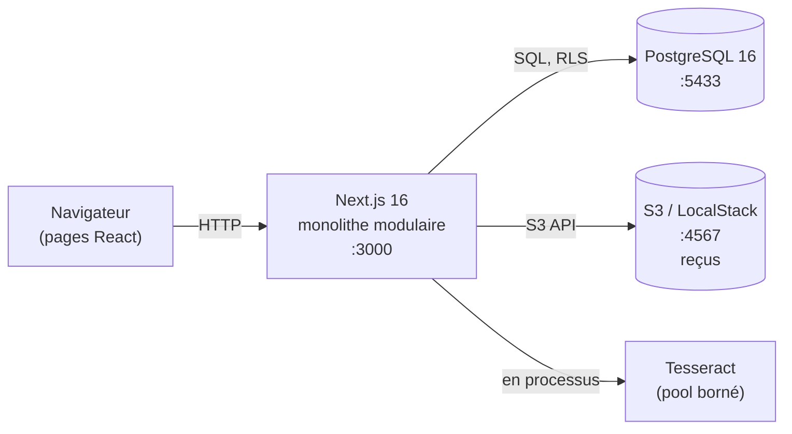
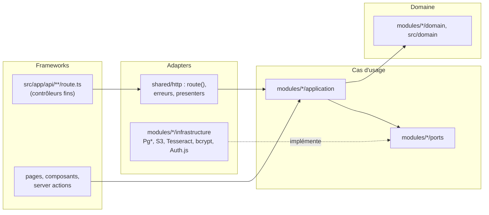
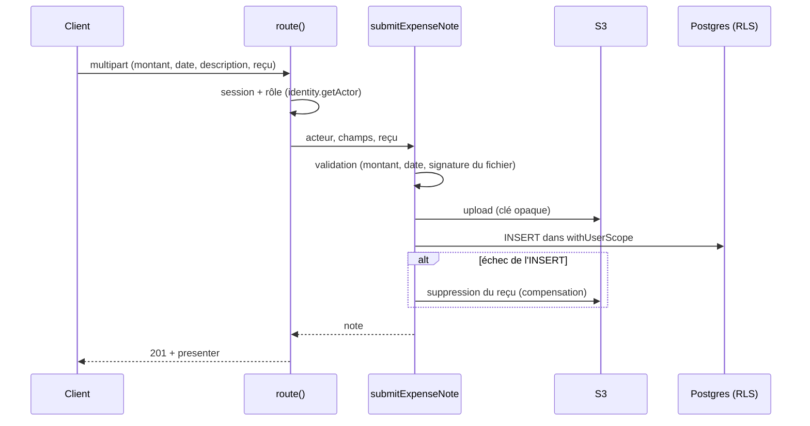

# HLD : architecture d'Expense.io

Vue d'ensemble de l'application après la refonte. Le détail de chaque module est dans son `README.md` (`src/modules/<module>/README.md`, le LLD). L'exploitation est décrite dans [DAT.md](DAT.md), et les décisions dans [adr/](adr/README.md).

## 1. Le système

Expense.io gère les notes de frais d'une entreprise. Un **employé** soumet une note avec son reçu. Son **manager** direct la valide ou la rejette. Les notes de quiconque n'a pas de manager (manager racine ou employé) vont à la **RH** de l'entreprise, qui gère aussi l'organigramme : elle nomme les managers et les autres RH, rattache chacun à son manager, et se rattache elle-même à un manager qui valide ses propres notes (sans manager, une autre RH les valide). Chaque entreprise est isolée des autres et se déduit du domaine de l'email à l'inscription (domaines de messagerie publics refusés). Décisions métier : ADR-012 à ADR-020.

## 2. Choix de découpage : monolithe modulaire

Un seul déploiement, découpé en modules métier qui ne se parlent que par leur `index.ts` ([ADR-002](adr/ADR-002-monolithe-modulaire.md)). Les microservices ont été écartés : le contrat est figé (routes, ports, scripts), le harnais de tests attaque une seule application, et la charge mesurée ne justifie pas plusieurs déploiements. Un module reste extractible plus tard, puisqu'il ne lit pas les tables des autres.

## 3. Modules

| Module | Responsabilité | Cas d'usage | Ports (sortie) | Adapters |
|---|---|---|---|---|
| [`identity`](../../src/modules/identity/README.md) | inscription, connexion, acteur de la session | `signup`, `authenticate`, `getActor` | `UserRepository`, `PasswordHasher` | Postgres, bcrypt, Auth.js |
| [`organization`](../../src/modules/organization/README.md) | annuaire de l'entreprise, rattachement à un manager, rôles, fiche RH | `listDirectory`, `assignManager`, `changeRole`, `getHrProfile`, `listHrAdmins` | `OrganizationRepository` | Postgres |
| [`expenses`](../../src/modules/expenses/README.md) | soumettre et consulter ses notes et leurs reçus | `submitExpenseNote`, `listMyExpenseNotes`, `getMyReceiptUrl` | `ExpenseTransaction`, `ReceiptStoragePort` | Postgres (RLS), S3 |
| [`approval`](../../src/modules/approval/README.md) | qui voit et tranche quelle note, décision atomique | `listPendingNotes`, `listApprovalQueue`, `decideExpenseNote`, `getReceiptUrlForApprover` | `ApprovalTransaction`, `ApprovalQueue`, `ReceiptStoragePort` | Postgres (RLS), S3 |
| [`receipt-scan`](../../src/modules/receipt-scan/README.md) | suggestion de montant et de date par OCR | `suggestFromReceipt` | `ReceiptScanner` | Tesseract (pool de workers) |
| [`shared`](../../src/modules/shared/README.md) | socle commun | garde HTTP `route()`, erreurs typées, presenters, transaction scopée, logger | — | — |

`src/domain/` (entités `ExpenseNote` et `User`), `src/ports/` et `src/adapters/` sont les couches historiques, ranimées et branchées ([ADR-004](adr/ADR-004-ranimer-le-domaine.md)) : les modules s'en servent. L'ancien `src/lib/` a été vidé dans les modules puis supprimé.

## 4. Règle de dépendance

Les dépendances vont toujours vers le domaine. Le domaine, les cas d'usage et les ports n'importent ni `pg`, ni `@aws-sdk/*`, ni `tesseract.js`, ni `bcryptjs`, ni Next.js, ni Auth.js, ni `@/lib/*`. Un module s'importe par son `index.ts`, jamais par ses fichiers internes. Le `index.ts` de chaque module est sa racine de composition : il instancie les adapters et les injecte dans les cas d'usage (`make<UseCase>(deps)`).

**Vérifié automatiquement :** ces règles sont dans `eslint.config.mjs` (`no-restricted-imports`) **en erreur**, si bien que `npm run lint` échoue dès qu'elles sont violées ([ADR-005](adr/ADR-005-regles-architecture-eslint.md)).

## 5. Isolation par entreprise

Elle tient en deux couches indépendantes ([ADR-006](adr/ADR-006-rls-effective.md), [ADR-007](adr/ADR-007-company-id-par-trigger.md)) :

1. **Repositories bornés à l'acteur** : chaque requête est filtrée sur l'acteur courant (ses notes, ses rattachés, son entreprise).
2. **RLS PostgreSQL effective** : les lectures et écritures de notes passent par `withUserScope`. Cette fonction ouvre une transaction, publie `app.current_user_id` et bascule sur le rôle sans privilège `APP_DB_ROLE`, si bien que les policies s'appliquent même en cas d'oubli dans une requête. `company_id` est recopié sur chaque note par un trigger.

## 6. Flux principaux

**Soumettre une note** (`POST /api/expense-notes`)

**Valider une note** (`POST /api/manager|hr/expense-notes/:id/approve|reject`) : `route()` vérifie le rôle, puis `decideExpenseNote` calcule le périmètre du valideur (`ApprovalPolicy`), lit la note dans ce périmètre (sinon `404`) et enregistre la décision par un `UPDATE … WHERE status = 'pending'`. Si une autre décision est passée avant, la réponse est `409 Already decided` (verrou optimiste, ROB-02).

**Liste du manager** (`GET /api/manager/expense-notes`) : `listApprovalQueue` lit les notes en attente du périmètre avec le nom de leur auteur, en une requête : les auteurs du périmètre sont calculés une fois, puis joints aux notes lues par l'index (D20, MET-08).

**Suggestion OCR** (`POST /api/expense-notes/receipt-suggestion`) : la taille est bornée (10 Mo), puis l'image est confiée au pool Tesseract (workers réutilisés, PERF-01), et le montant et la date sont extraits du texte. Le traitement reste synchrone, sans file de messages ([ADR-008](adr/ADR-008-pas-de-socle-asynchrone.md)).

## 7. Contrat

Le contrat couvre les routes, codes HTTP, JSON, messages, textes de l'interface, scripts npm, ports et variables d'environnement. L'API est décrite dans `docs/api/openapi.yaml` (version 2.0.0) et vérifiée sur chaque réponse par les tests de parité. Elle n'a évolué que par décision d'équipe, en semver : codes 401 / 403 (D12) et messages en anglais (D15), changements cassants ; trois routes RH (D13, D14) et le champ `authorName` (D20), ajouts. L'historique est en tête du fichier. Voir `AGENTS.md` (règles 3 et 5) et `docs/tests/criteres-fin-de-migration.md`.
