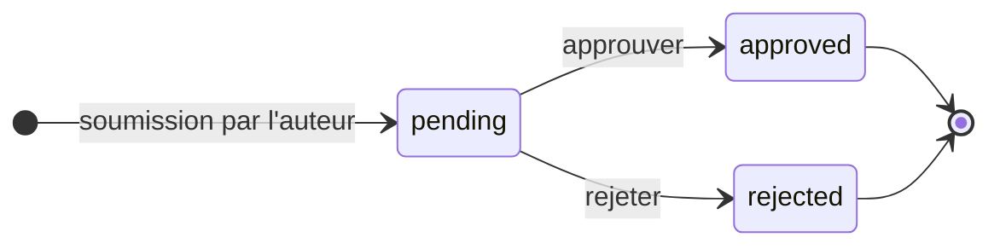
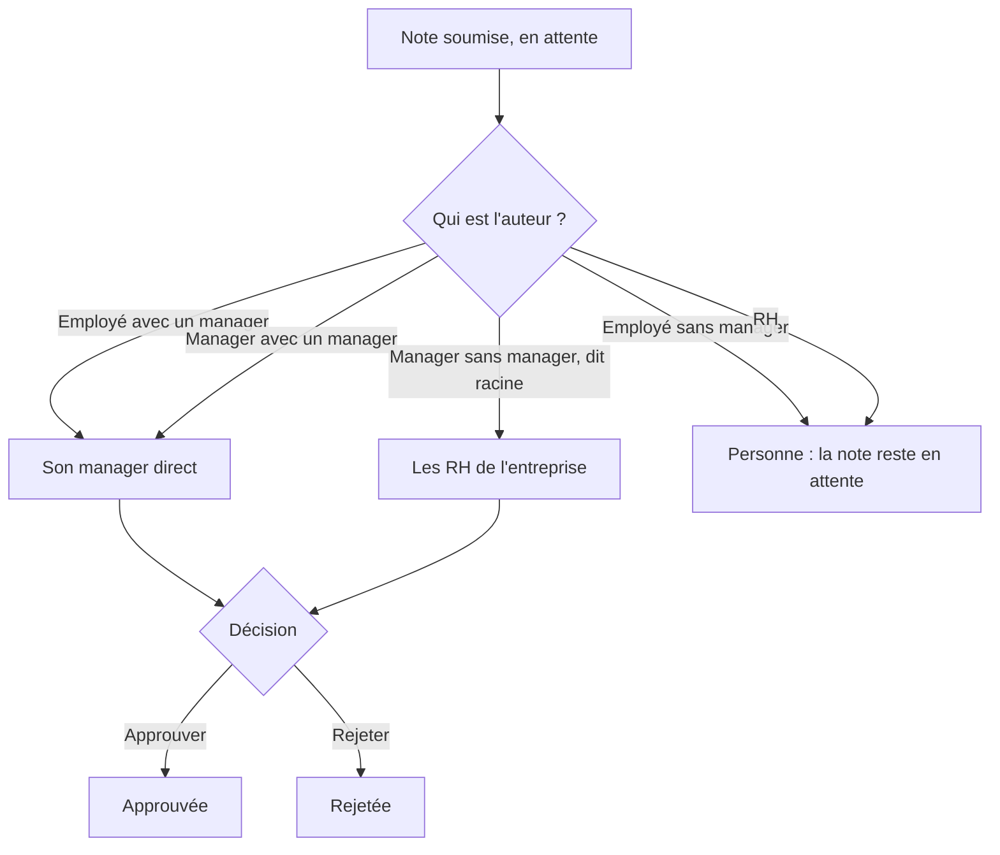
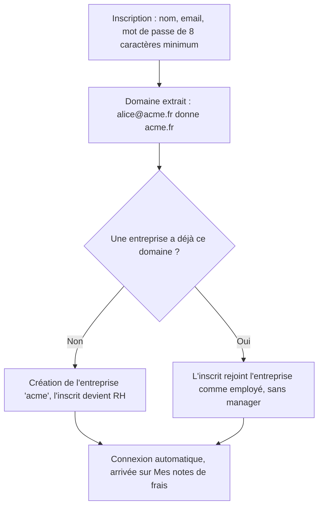

# 01 — Produit (vue métier)

## En une phrase

Un circuit de validation de notes de frais, par entreprise. Un salarié déclare
une dépense avec son justificatif ; son manager direct l'approuve ou la
rejette ; les managers sans supérieur sont validés par les RH ; les RH tiennent
l'organigramme (qui valide qui). Une entreprise est identifiée par le domaine
de l'adresse email de ses membres.

## Rôles

Valeurs stockées dans `users.role` : `employee`, `manager`, `hr_admin`.

| Rôle | Capacités |
|---|---|
| **Employé** (`employee`) | Soumet ses notes avec justificatif ; peut pré-remplir montant et date depuis le reçu (OCR) ; consulte son historique, les statuts et ses reçus. |
| **Manager** (`manager`) | Tout ce que fait un employé + voit les notes *en attente* de ses subordonnés directs, ouvre le reçu, approuve ou rejette. |
| **RH** (`hr_admin`) | Tout ce que fait un employé + gère l'organigramme (attribue un manager à chaque employé ou manager) + valide les notes des managers « racine » (sans manager). |

## Matrice des droits

| Capacité | Employé | Manager | RH |
|---|---|---|---|
| Créer son compte via `/signup` | oui, si le domaine existe déjà | **non** — seed ou base uniquement | oui, 1er inscrit du domaine |
| Soumettre une note de frais | oui | oui | oui, mais **personne ne la valide** (M-01) |
| Voir son historique et ses reçus | oui | oui | oui |
| Pré-remplir depuis le reçu (OCR) | oui | oui | oui |
| Voir les notes à valider | — | subordonnés directs | managers racine de son entreprise |
| Approuver / rejeter | — | subordonnés directs | managers racine de son entreprise |
| Attribuer un manager | — | — | oui |
| Changer le rôle de quelqu'un | — | — | **impossible dans l'interface** |

## La note de frais

| Champ | Règle |
|---|---|
| Montant | strictement positif, 2 décimales, euros uniquement |
| Date | obligatoire, aucune borne (une date future passe) |
| Description | texte libre non vide, pas de longueur max |
| Reçu | obligatoire ; PNG, JPEG, WebP ou PDF ; 10 Mo max |
| Statut | toujours `pending` (en attente) à la création |

Pas de catégorie, pas de TVA, pas de devise. Une note **ne peut plus être
modifiée ni supprimée** après envoi, par personne.

## Cycle de vie

La décision est définitive. Aucun motif de rejet ; ni l'auteur ni la date de la
décision ne sont conservés.

Libellés affichés : `pending` = « en attente », `approved` = « approuvée »,
`rejected` = « rejetée ».

## Circuit d'approbation

Le valideur dépend de la position de l'auteur dans l'organigramme. Le lien est
calculé **à la lecture** à partir du manager actuel de l'auteur : si les RH
changent le manager d'un employé, ses notes en attente partent chez le nouveau
manager. Un seul niveau de validation, pas d'escalade, pas de seuil de montant.

## Inscription et rattachement à une entreprise

Ni invitation ni validation : le domaine de l'email suffit.

Le rôle `manager` n'est attribuable que par le script de seed ou directement
en base.

## Écrans

| URL | Qui | Contenu |
|---|---|---|
| `/` | visiteur | Accueil, boutons « Se connecter » / « Créer un compte ». Un utilisateur connecté est redirigé vers `/expenses`. |
| `/login`, `/signup` | visiteur | Formulaires de connexion et d'inscription. Pas de mot de passe oublié. |
| `/expenses` | tout connecté | « Mes notes de frais » : compteur et total, formulaire de soumission avec « Pré-remplir depuis le reçu », historique avec statut et « Voir le reçu ». |
| `/manager` | manager | « Validation des notes de frais » : notes en attente des subordonnés, avec Voir le reçu / Approuver / Rejeter. L'employé est affiché par les 8 premiers caractères de son id technique, pas par son nom. |
| `/hr` | RH | « Espace RH » : organigramme (un menu « Manager » par personne), puis notes en attente des managers racine avec les mêmes actions. |

La barre du haut affiche « Manager » ou « RH » selon le rôle, l'email et
« Se déconnecter ». Pas de lien direct vers « Mes notes » : on y revient par
le logo (`/` redirige vers `/expenses`).

## Angles morts métier

| ID | Constat |
|---|---|
| M-01 | **Notes qui n'arrivent chez personne.** Les notes d'un employé sans manager et toutes les notes des RH ne figurent dans aucune liste de validation et restent en attente indéfiniment. Or tout nouvel inscrit arrive sans manager. |
| M-02 | **Entreprises créées par inscription : circuit impossible.** Le rôle manager n'est pas attribuable depuis l'interface. Une entreprise née d'une inscription n'a jamais de manager ; les RH n'ont personne à choisir dans l'organigramme. |
| M-03 | **Domaines d'email partagés.** Tous les inscrits en `@gmail.com` forment une même « entreprise » dont le premier devient RH. |
| M-04 | **Total qui mélange les statuts.** Le total de « Mes notes » additionne toutes les notes, rejetées comprises (`src/app/expenses/page.tsx:155`). |
| M-05 | **Décisions sans contexte.** Pas de motif de rejet, pas de notification à l'auteur (une classe console existe mais n'est jamais appelée), pas de trace de qui a décidé et quand. |
| M-06 | **Le manager ne sait pas de qui vient la note.** Identifiant tronqué au lieu du nom (`src/components/PendingApprovalsPanel.tsx:117`) ; les RH, elles, voient le nom. |
| M-07 | **Organigramme trompeur.** Dans `/hr`, « — aucun (racine) — » s'affiche aussi pour un *employé* sans manager, alors que « racine » n'a de sens métier que pour un manager. |

### Absent du produit

Modification/suppression d'une note · brouillon · catégories, TVA, devises ·
plafonds et règles de dépense · remboursement/paiement · export comptable ·
filtres, recherche, pagination · historique des notes déjà décidées côté
valideur · mot de passe oublié · invitation · gestion des rôles.

## Jeu de démo (`make dev` / `npm run seed`)

| Rôle | Email | Mot de passe | Situation |
|---|---|---|---|
| hr_admin | `hr@expense.io` | `hr1234` | Valide « Café client (seed) » du manager racine |
| manager | `manager@expense.io` | `manager1234` | Racine. Valide « Taxi aéroport (seed) » |
| employee | `demo@expense.io` | `demo1234` | Rattaché au manager ci-dessus |

Le seed est idempotent (relançable sans doublons). Les reçus de démo sont un
PNG 1×1.
