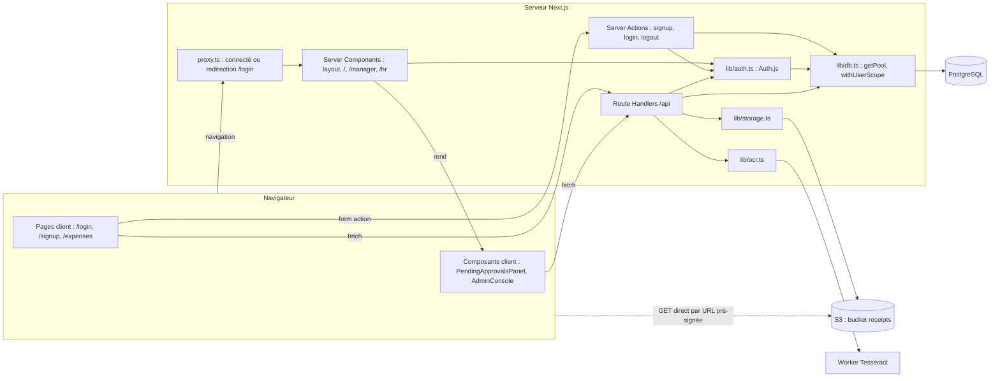

# 02 — Architecture

## Stack

| Brique | Techno | Rôle dans l'app |
|---|---|---|
| Front + back | Next.js 16.3 (App Router, Turbopack), React 19.2 | Pages, Server Actions, Route Handlers `/api`. `src/proxy.ts` remplace `middleware.ts` depuis Next 16. |
| Authentification | Auth.js (`next-auth` 5 beta), provider Credentials, `bcryptjs` | Session JWT en cookie, contenant `id` et `role`. |
| Base de données | PostgreSQL 16, driver `pg`, `node-pg-migrate` | 3 tables, RLS sur `expense_notes`. SQL à la main, pas d'ORM. |
| Stockage des reçus | S3 via AWS SDK v3 (LocalStack 3.8.1 en local) | Bucket `receipts`, lecture par URL pré-signée (300 s). |
| OCR | `tesseract.js` 7, modèle `tessdata/fra.traineddata.gz` | Suggère montant et date depuis une image de reçu. |
| UI | Tailwind CSS 4, polices Geist | Couleurs `brand-*` dans `src/app/globals.css`. |
| Outillage | Makefile, docker-compose, ESLint, `tsc` | `make dev` = install → Docker → migrations → bucket → seed → serveur. **Aucun test.** |

Ports locaux : Postgres `5433`, LocalStack `4567`, app `3000`.

Variables d'environnement (`.env.example`) : `DATABASE_URL`, `AUTH_SECRET`
(**ignorée**, voir V-08), `AUTH_TRUST_HOST`, `S3_ENDPOINT`, `S3_REGION`,
`S3_ACCESS_KEY_ID`, `S3_SECRET_ACCESS_KEY`, `S3_BUCKET`, `S3_FORCE_PATH_STYLE`.

## Composants et dépendances réelles

Seuls les liens existant réellement dans le code sont tracés.



Toute la logique métier vit dans les Route Handlers. Il n'y a pas de couche
service.

## Briques transverses (`src/lib`)

| Fichier | Ce qu'il fait |
|---|---|
| `lib/db.ts` | Pool `pg` global (max 20), parser de `date` qui garde la chaîne `YYYY-MM-DD`. `withUserScope(userId, fn)` : `BEGIN` → `set_config('app.current_user_id', id, true)` → `fn(client)` → `COMMIT` / `ROLLBACK`. |
| `lib/auth.ts` | Config Auth.js : Credentials (SELECT par email + `bcrypt.compare`), callbacks `jwt`/`session` qui recopient `id` et `role`. Secret codé en dur (V-08). |
| `lib/storage.ts` | Client S3 paresseux, `receiptKeyFor(seq, ext)` → `receipts/<seq><ext>`, `uploadReceipt`, `getReceiptUrl` (pré-signée 300 s). |
| `lib/ocr.ts` | `suggestFields({data, mimeType})` : worker Tesseract `fra` créé et détruit à chaque appel, puis `parseAmount` / `parseExpenseDate` par regex. Renvoie `{}` en cas d'erreur ou de type non image. |
| `lib/errors.ts` | `respondError` : log + 500 avec `error` et `stack` (V-11). |

## Arborescence annotée

`[mort]` = jamais importé · `(!)` = voir [07-points-de-vigilance.md](07-points-de-vigilance.md)

```text
src/
├─ proxy.ts                         redirige vers /login si non connecté (hors /api)
├─ app/
│  ├─ layout.tsx                    header, nav selon le rôle, bouton déconnexion
│  ├─ page.tsx                      accueil ; redirige vers /expenses si connecté
│  ├─ login/ · signup/              formulaires client (useActionState)
│  ├─ expenses/page.tsx             client : formulaire, OCR, historique
│  ├─ manager/page.tsx              serveur : test du rôle, puis <PendingApprovalsPanel/>
│  ├─ hr/page.tsx                   serveur : test du rôle, puis <AdminConsole/>
│  ├─ actions/auth.ts               Server Actions signup, login, logout (!)
│  └─ api/
│     ├─ auth/[...nextauth]         handlers Auth.js
│     ├─ expense-notes/             GET liste (!), POST création (!)
│     │  ├─ receipt-suggestion/     POST OCR
│     │  └─ [id]/receipt-url/       GET URL pré-signée (propriétaire)
│     ├─ manager/expense-notes/     GET en attente
│     │  └─ [id]/ approve · reject · receipt-url (!)
│     └─ hr/
│        ├─ expense-notes/          GET en attente des managers racine
│        │  └─ [id]/ approve · reject · receipt-url
│        └─ users/ · [id]/manager/  annuaire, PUT rattachement (!)
├─ components/                      NavItem, PendingApprovalsPanel, AdminConsole
├─ lib/
│  ├─ auth.ts                       config Auth.js, secret en dur (!)
│  ├─ db.ts                         pool pg global, withUserScope
│  ├─ storage.ts                    S3 : upload, URL pré-signée, nom de clé
│  ├─ ocr.ts                        Tesseract + heuristiques regex
│  └─ errors.ts                     500 avec message et stack (!)
├─ domain/    ExpenseNote, User                     [mort]
├─ ports/     NotificationPort, ReceiptStoragePort  [mort]
├─ adapters/  ConsoleNotification, S3Receipt        [mort]
├─ utils/     format, validators                    [mort]
└─ types/next-auth.d.ts             augmente Session et JWT avec id et role
migrations/1700000000001_init-schema.sql   schéma + policies RLS
scripts/seed.mjs                    jeu de démo idempotent
scripts/ensure-bucket.mjs           crée le bucket S3 (15 tentatives)
tessdata/fra.traineddata.gz         modèle OCR français
```

## Code mort (vérifié par grep des imports)

| Fichier | Importé par |
|---|---|
| `src/domain/ExpenseNote.ts` | personne |
| `src/domain/User.ts` | personne |
| `src/ports/NotificationPort.ts` | `adapters/ConsoleNotificationAdapter.ts` (lui-même mort) |
| `src/ports/ReceiptStoragePort.ts` | `adapters/S3ReceiptAdapter.ts` (lui-même mort) |
| `src/adapters/*` | personne |
| `src/utils/format.ts` | personne (formatteurs redéfinis dans chaque composant) |
| `src/utils/validators.ts` | personne (regex email redéfinie dans `actions/auth.ts`) |

Autres éléments sans effet : le repli `path.extname(receipt.name)` dans
`src/app/api/expense-notes/route.ts:98` (le type est déjà filtré par liste
blanche) ; le champ `receiptKey` du DTO JSON (jamais lu côté client) ;
`agentRules: false` dans `next.config.ts`.
