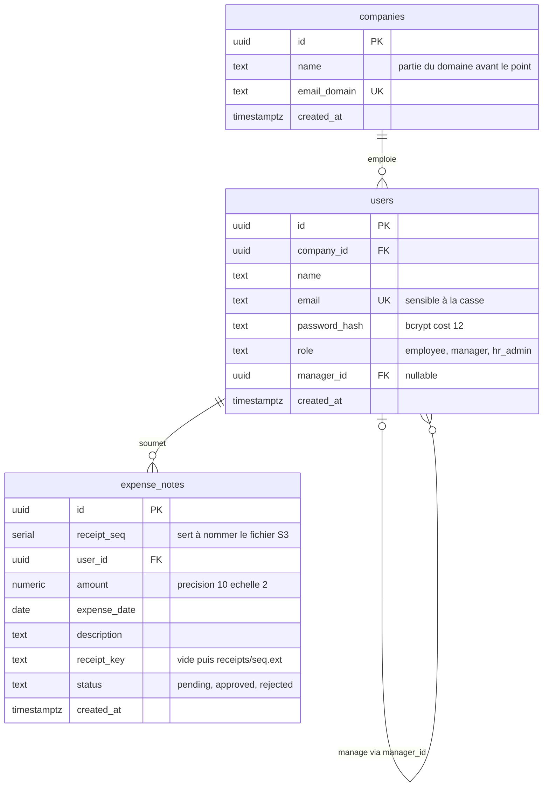
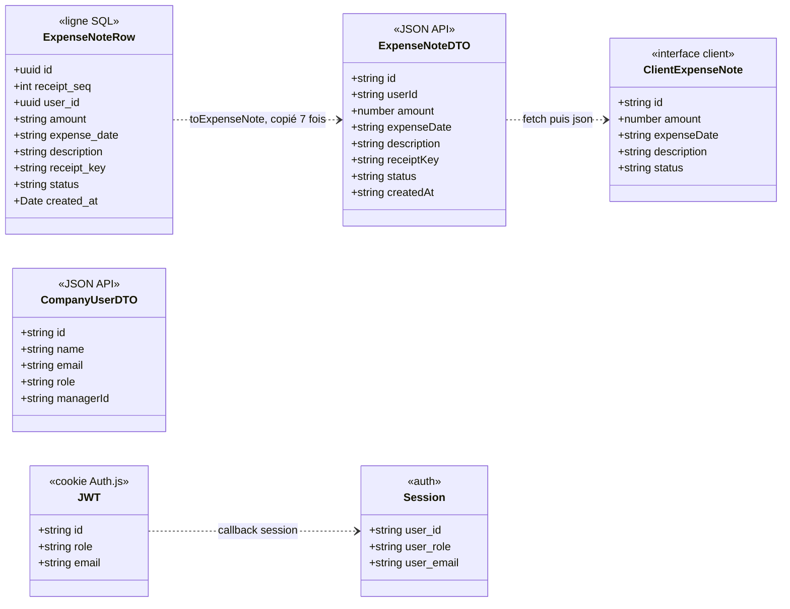
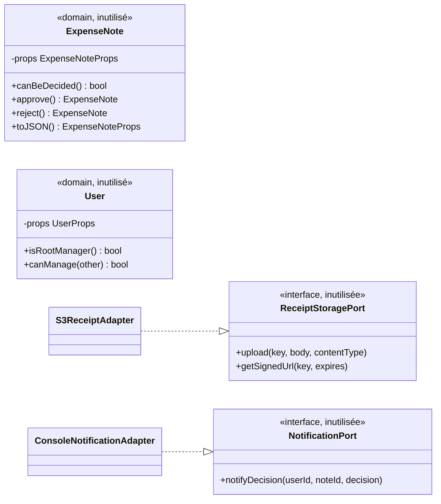

# 03 — Données et objets manipulés

Source : `migrations/1700000000001_init-schema.sql` (migration unique).

## Schéma

L'organigramme est un arbre porté par l'auto-référence `users.manager_id`.
L'entreprise n'est pas stockée sur la note : on la retrouve via l'auteur.

Contraintes notables :

- `users.role` : `CHECK IN ('employee','manager','hr_admin')`, défaut `employee`.
- `expense_notes.status` : `CHECK IN ('pending','approved','rejected')`, défaut `pending`.
- `users.manager_id` : aucune contrainte « même entreprise », aucune contrainte anti-cycle.
- Aucun index secondaire (hors PK/UK) : `expense_notes.user_id` et `users.manager_id` ne sont pas indexés.
- La migration « down » supprime les tables mais pas les policies ni l'extension `pgcrypto` (sans conséquence, les policies tombent avec la table).

## Policies RLS (`expense_notes` uniquement)

`ENABLE` + `FORCE ROW LEVEL SECURITY`. Les policies lisent la variable
`app.current_user_id`, posée par `withUserScope()` (`src/lib/db.ts:28-46`).
Elles sont **permissives** : une ligne est accessible dès qu'une policy
l'autorise.

| Policy | Opération | Autorise si… |
|---|---|---|
| `expense_notes_owner_select` | SELECT | la note est à moi |
| `expense_notes_owner_insert` | INSERT | la note créée est à moi |
| `expense_notes_manager_select` | SELECT | l'auteur a `manager_id` = moi |
| `expense_notes_manager_update` | UPDATE | idem |
| `expense_notes_hr_root_manager_select` | SELECT | l'auteur est un manager racine **et** je suis `hr_admin` — l'entreprise **n'est pas vérifiée** |
| `expense_notes_hr_root_manager_update` | UPDATE | idem |

- Pas de policy UPDATE pour le propriétaire, pas de policy DELETE.
- `users` et `companies` n'ont pas de RLS.
- **Très probablement inopérant** dans la configuration actuelle : voir V-05 et
  [06-autorisation.md](06-autorisation.md).

## Objets réellement en circulation

Aucune classe métier n'intervient à l'exécution. Une ligne `pg` est mappée à
la main en DTO JSON (snake_case → camelCase, `numeric` string → `number`),
puis relue côté client dans une interface redéclarée dans chaque composant.

| Objet | Où il est défini |
|---|---|
| Mapping ligne → DTO | `toExpenseNote` dans `api/expense-notes/route.ts`, `api/manager/expense-notes/route.ts`, `api/hr/expense-notes/route.ts` + 4 copies inline dans les routes approve/reject |
| Interface client `ExpenseNote` | redéclarée dans `app/expenses/page.tsx`, `components/PendingApprovalsPanel.tsx`, `components/AdminConsole.tsx` (champs légèrement différents) |
| `CompanyUserDTO` | construit dans `api/hr/users/route.ts` et `api/hr/users/[id]/manager/route.ts` ; interface `CompanyUser` dans `AdminConsole.tsx` |
| Type `UserRole` | déclaré 3 fois : `domain/User.ts`, `types/next-auth.d.ts`, inline dans `lib/auth.ts` |
| Session / JWT | `types/next-auth.d.ts` + callbacks dans `lib/auth.ts`. Le rôle est figé dans le JWT au login. |

## Couche « domaine » prévue mais jamais branchée

Ces classes ont l'allure d'une architecture hexagonale, mais aucune route ne
les importe. La règle « une note déjà tranchée ne peut plus l'être » est
réécrite en SQL + JS dans chacune des 4 routes approve/reject, et
`notifyDecision` n'est jamais appelé.

## Stockage objet (S3)

- Bucket : `S3_BUCKET` (défaut `receipts`).
- Clé : `receipts/<receipt_seq><ext>` — `receipt_seq` est un `serial`, donc
  séquentiel et devinable (V-10).
- `ContentType` = type MIME annoncé par le navigateur, non vérifié sur le contenu.
- Lecture uniquement par URL pré-signée `GetObject`, valable 300 s, ouverte
  directement par le navigateur.
