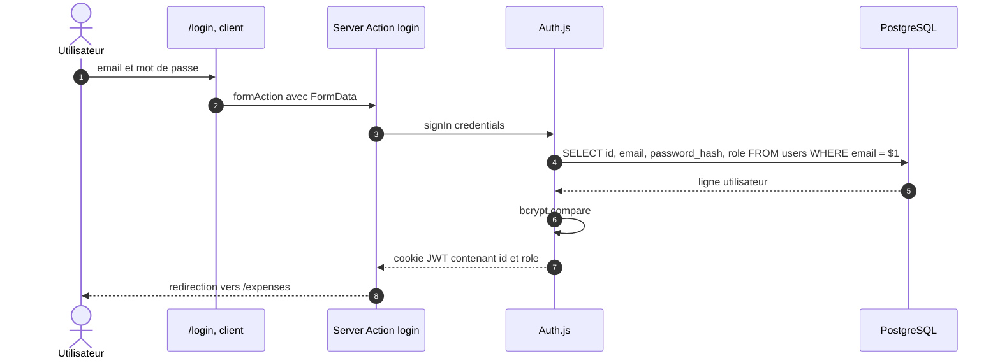
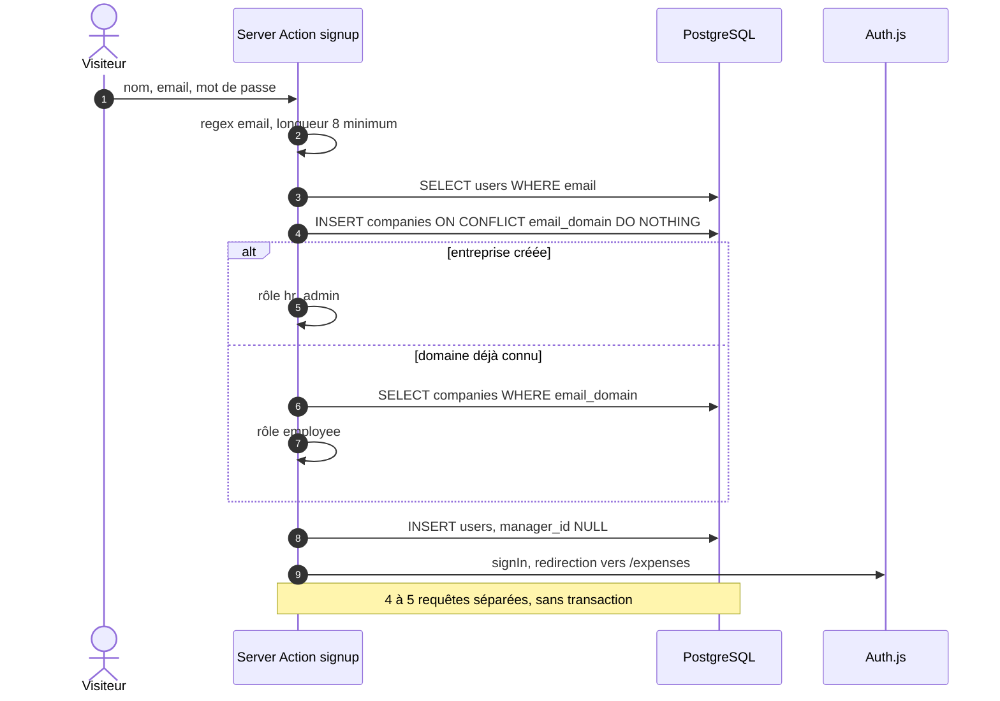
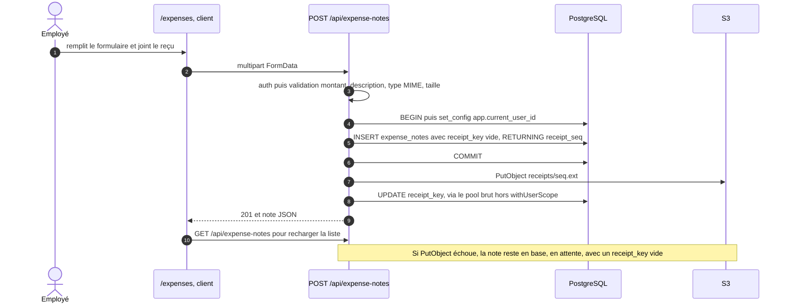
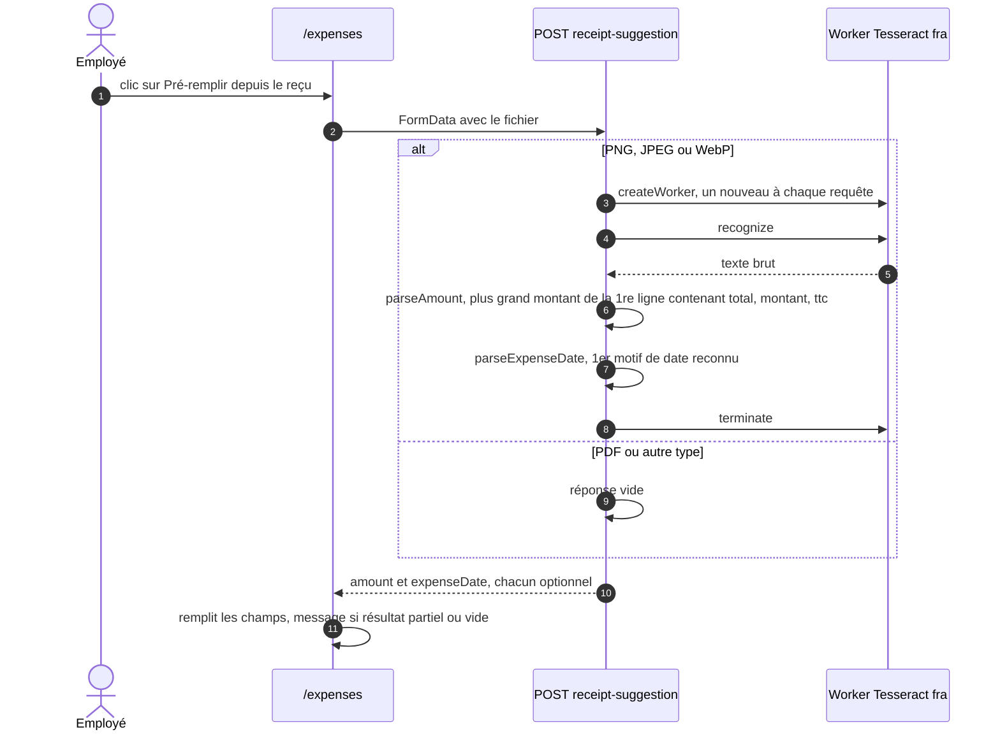
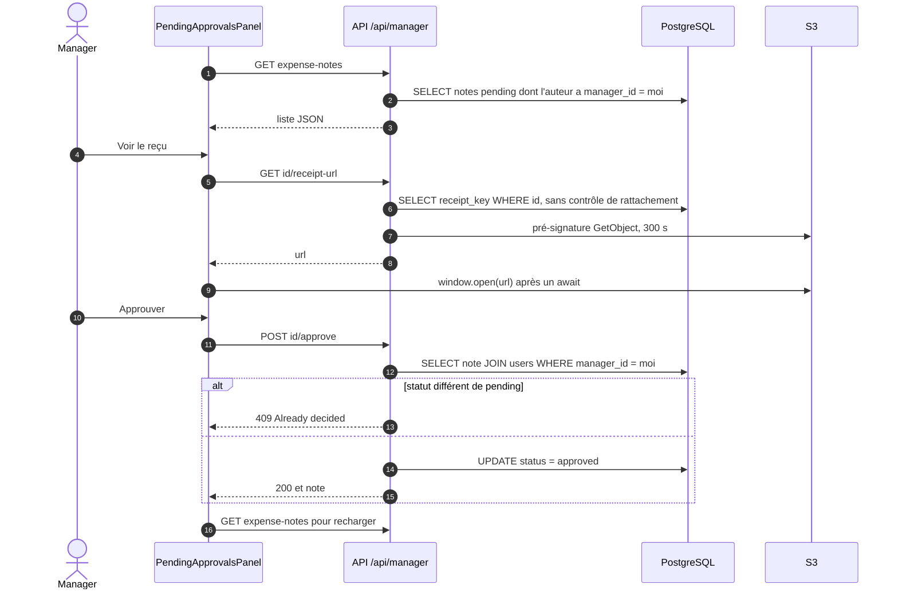
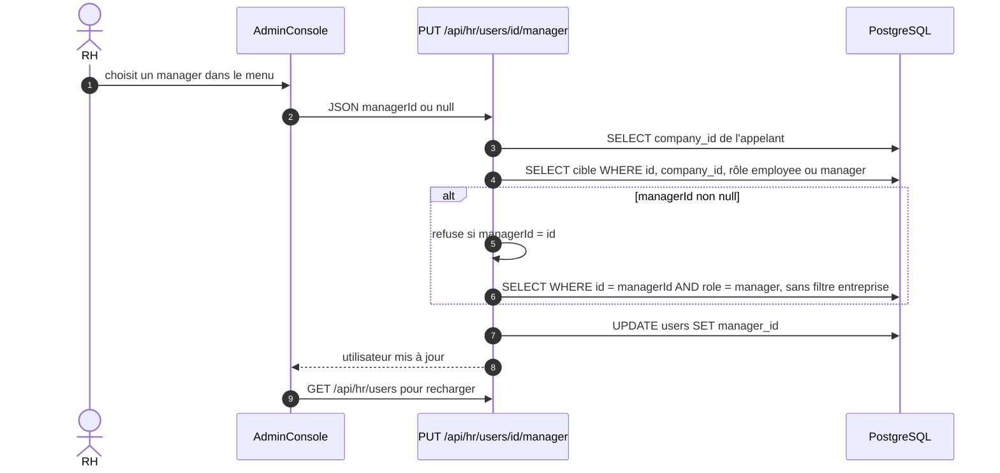

# 05 — Flux (diagrammes de séquence)

## 1. Connexion

Le rôle est figé dans le JWT au login : un changement de rôle en base n'est
pris en compte qu'à la reconnexion suivante.

Code : `src/app/actions/auth.ts:82-102`, `src/lib/auth.ts:22-59`.

## 2. Inscription

Code : `src/app/actions/auth.ts:15-80`. Voir V-12, M-02, M-03.

## 3. Création d'une note de frais

La date n'est pas validée côté serveur : une chaîne invalide est rejetée par
Postgres et renvoie une 500 avec la stack.

Code : `src/app/api/expense-notes/route.ts:56-112`. Voir V-05, V-10, V-11.

## 4. Pré-remplissage par OCR

Le formulaire accepte les PDF mais l'OCR les ignore : sur un PDF, le
pré-remplissage répond toujours « Aucune information reconnue ».

Détail des heuristiques (`src/lib/ocr.ts`) :

- **Montant** : prend la *première* ligne contenant `total|montant|ttc|à payer|net à`
  (sinon toutes les lignes), y cherche les nombres décimaux et garde le plus
  grand. À défaut, entiers sur les lignes avec mot-clé ou `€`/`EUR`.
- **Date** : premier motif trouvé dans l'ordre `jj/mm/aaaa`, `aaaa-mm-jj`,
  `jj/mm/aa` (→ 20aa), `jj mois aaaa` en français.

Code : `src/app/api/expense-notes/receipt-suggestion/route.ts`,
`src/lib/ocr.ts:109-134`. Voir V-13.

## 5. Validation par le manager

Le parcours RH (`AdminConsole`, routes `/api/hr/…`) est identique, avec un
filtre « auteur manager racine de mon entreprise ».

Code : `src/components/PendingApprovalsPanel.tsx`,
`src/app/api/manager/expense-notes/**`. Voir V-06, V-09, V-14.

## 6. Rattachement d'un collaborateur (RH)

Code : `src/app/api/hr/users/[id]/manager/route.ts`. Requêtes hors
transaction et hors `withUserScope`. Voir V-04.
