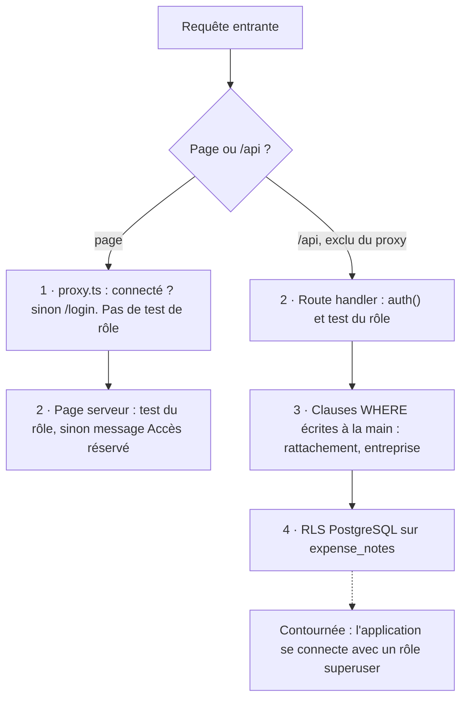

# 06 — Autorisation : ce qui protège réellement les données

## Quatre couches, dont deux sans effet pratique



| Couche | Où | Ce qu'elle garantit |
|---|---|---|
| 1. Proxy | `src/proxy.ts` | Pages `/expenses`, `/manager`, `/hr` : redirige vers `/login` si pas de session. Ne couvre pas `/api`. Ne teste pas le rôle. |
| 2. Test du rôle | début de chaque `route.ts` ; `app/manager/page.tsx`, `app/hr/page.tsx` | Le rôle vient du JWT (V-08 : secret en dur, donc JWT forgeable). |
| 3. Clauses `WHERE` | chaque requête SQL | **Seule protection réelle des données**, et elle varie d'une route à l'autre (V-03). |
| 4. RLS | migration | Très probablement inopérante (ci-dessous). |

## Pourquoi la RLS est très probablement décorative (V-05)

- `docker-compose.yml` crée l'utilisateur `expense` via `POSTGRES_USER`.
  L'image officielle Postgres crée ce rôle en **superuser**.
- `DATABASE_URL` (`.env.example`) utilise ce même utilisateur.
- Un superuser (ou un rôle `BYPASSRLS`) ignore la RLS, même avec
  `FORCE ROW LEVEL SECURITY`.
- Indice dans le code : `POST /api/expense-notes`
  (`src/app/api/expense-notes/route.ts:103-106`) fait un `UPDATE` via
  `getPool()`, **sans** `app.current_user_id` et alors qu'aucune policy UPDATE
  n'existe pour le propriétaire. Sous RLS effective, cet UPDATE ne toucherait
  aucune ligne et `updated.rows[0]` serait `undefined` → la route planterait.
  Elle fonctionne, donc la RLS est contournée. Le seed
  (`scripts/seed.mjs:94`) fait de même.
- Par ailleurs, la policy RH ne filtre pas par entreprise : même effective,
  elle laisserait un RH lire les notes des managers racine de toutes les
  entreprises.

**Non vérifié à l'exécution** (Docker arrêté). Pour confirmer :

```sql
SELECT rolname, rolsuper, rolbypassrls FROM pg_roles WHERE rolname = current_user;
```

## Usage de `withUserScope` vs pool brut

| Route | Accès DB |
|---|---|
| `GET/POST /api/expense-notes` | `withUserScope` (INSERT/SELECT) **+ pool brut** (UPDATE receipt_key) |
| `GET /api/expense-notes/[id]/receipt-url` | `withUserScope` |
| `/api/manager/expense-notes` (GET, approve, reject) | `withUserScope` |
| `GET /api/manager/expense-notes/[id]/receipt-url` | **pool brut, aucun filtre** |
| `/api/hr/expense-notes/**` | `withUserScope` |
| `/api/hr/users`, `/api/hr/users/[id]/manager` | pool brut (tables sans RLS) |
| `lib/auth.ts`, `actions/auth.ts` | pool brut |

Le choix entre les deux ne suit aucune règle visible.

## Les trois versions de « obtenir l'URL d'un reçu »

| Route | Stratégie |
|---|---|
| `/api/expense-notes/[id]/receipt-url` | `withUserScope` + `WHERE id AND user_id = moi` |
| `/api/hr/expense-notes/[id]/receipt-url` | `withUserScope` + `WHERE` manager racine + même entreprise |
| `/api/manager/expense-notes/[id]/receipt-url` | pool brut + `WHERE id` seulement — le commentaire justifie l'absence de contrôle |
