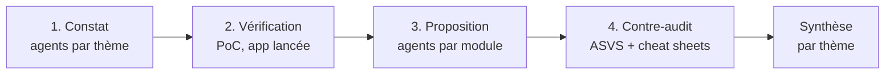

# 11 — Méthode d'audit

Ce document fixe **comment** l'audit est mené et **sous quelle forme** les
résultats sont rendus. Il sert de contrat commun : à l'équipe pour lire et
contester les résultats, aux agents pour produire des fiches homogènes.

- Rédigé le : 2026-10-12
- Point de départ : la cartographie (`01` à `07`), constats `V-00` à `V-16`
  et `M-01` à `M-07`.
- Nature du rendu : **intermédiaire**. Il sert à présenter le travail d'audit
  à l'équipe et de base de travail pour la suite (implémentation des
  correctifs, préparation de soutenance).

## Ce que l'audit fait, et ne fait pas

| Fait | Ne fait pas |
|---|---|
| Évalue chaque constat (gravité, effort), avec preuve | Modifier le code d'`expense-io/` |
| Confirme les constats graves en exécutant l'app en local | Tester autre chose que l'instance locale (`make dev`) |
| **Propose** des correctifs, avec extraits de code indicatifs | Appliquer ces correctifs (étape suivante, en équipe) |
| Cherche ce que la cartographie a manqué | Réécrire la cartographie |

Les PoC tournent contre la **base de dev locale** et y laissent des données
(comptes et notes de test). `make clean && make dev` remet tout à zéro.

## Pipeline



| Phase | Qui | Produit | Fichier |
|---|---|---|---|
| 1. Constat | Un agent par thème (T1…T8) | Fiches : problème, emplacement, gravité, étiquettes, piste en une ligne, effort | `12-constats.md` |
| 2. Vérification | Agents PoC, app lancée | Statut de vérification, gravité ajustée, scripts rejouables | `12-constats.md`, `poc/` |
| 3. Proposition | Un agent par module | Correctif conçu, visible ou non, tests de non-régression, lot | `13-plan-remediation.md` |
| 4. Contre-audit | Agent relecteur distinct | Chaque correctif confronté aux référentiels : conforme, insuffisant, à revoir | `13-plan-remediation.md` |
| Synthèse | Consolidation | Vue par thème, top risques, changements visibles à valider | `10-synthese.md` |

**Pourquoi séparer constat et correctif.** Constater établit un fait,
corriger est un choix. Les mélanger biaise le constat (on minimise ce qui est
dur à corriger, on s'arrête à la première explication). Les correctifs sont
conçus **par module**, avec tous les constats du module sous les yeux, parce
que plusieurs partagent une cause : les concevoir fiche par fiche donnerait
un patchwork. Enfin, un désaccord sur un correctif ne doit pas faire douter
du constat. Exception assumée : chaque fiche porte une **piste en une ligne**,
nécessaire pour appliquer la règle de granularité et estimer l'effort.

## Étiquettes

Chaque fiche porte trois étiquettes.

### Thème (A) — ce qui est en jeu

Structure la synthèse et la présentation. Les agents de phase 1 travaillent
un thème chacun.

| Code | Thème | Exemples de la cartographie |
|---|---|---|
| T1 | Authentification et secrets | V-08, V-12 (casse des emails) |
| T2 | Autorisation et isolation entre entreprises | V-03, V-04, V-05, V-06 |
| T3 | Injection et validation des entrées | V-07, V-10 (date, montant, MIME) |
| T4 | Intégrité des données et concurrence | V-09, V-10 (atomicité), V-12 (transaction) |
| T5 | Robustesse et exploitation | V-11, V-13, V-14, V-15 |
| T6 | Maintenabilité et tests | V-00, V-01, V-02, V-16 |
| T7 | Dépendances, configuration et données personnelles | `npm audit`, versions, `docker-compose`, reçus et emails (RGPD) |
| T8 | Circuit métier | M-01 à M-07 |

Une fiche a **un seul** thème principal. En cas d'hésitation : le thème du
risque le plus grave que le constat fait courir.

### Module (C) — où l'on corrige

Sert à construire les lots de correction. Un module principal, d'éventuels
modules secondaires.

| Code | Périmètre (chemins relatifs à `expense-io/`) |
|---|---|
| `auth` | `src/lib/auth.ts`, `src/app/actions/auth.ts`, `src/app/api/auth/**`, `src/proxy.ts`, `src/app/{login,signup}/`, `src/types/next-auth.d.ts` |
| `notes` | `src/app/api/expense-notes/route.ts`, `src/app/expenses/page.tsx` |
| `validation` | `src/app/api/manager/**`, `src/app/api/hr/expense-notes/**` (hors reçus), `src/components/PendingApprovalsPanel.tsx`, `src/app/manager/` |
| `organigramme` | `src/app/api/hr/users/**`, `src/components/AdminConsole.tsx`, `src/app/hr/` |
| `recus` | `src/lib/storage.ts`, les 3 routes `**/receipt-url/route.ts`, `scripts/ensure-bucket.mjs` |
| `ocr` | `src/lib/ocr.ts`, `src/app/api/expense-notes/receipt-suggestion/`, `tessdata/` |
| `donnees` | `src/lib/db.ts`, `migrations/`, `scripts/seed.mjs` |
| `socle` | `src/lib/errors.ts`, `src/app/layout.tsx`, `src/components/NavItem.tsx`, code mort (`src/{domain,ports,adapters,utils}`), config (`package.json`, `next.config.ts`, `docker-compose.yml`, `.env.example`, `Makefile`) |

### Référence (B) — quel référentiel

- **Constats de sécurité** : catégorie **OWASP Top 10 2025** (`A01` à
  `A10`). Sert surtout à la checklist de couverture ci-dessous.
- **Correctifs de sécurité (phases 3-4)** : exigences **OWASP ASVS 5.0**
  (identifiant exact de l'exigence) et **OWASP Cheat Sheets** (nom de la
  fiche). Toute référence citée doit avoir été vérifiée dans le texte source,
  pas citée de mémoire.
- **Constats et correctifs hors sécurité** (maintenabilité, métier) : pas de
  référentiel imposé. La justification repose sur la preuve et les tests de
  non-régression.

L'ancienne étiquette `lecture` / `risque` de la cartographie est conservée
dans `07` pour mémoire. La cotation ci-dessous la remplace dans l'audit.

## Cotation

### Gravité = impact × vraisemblance

| Impact ↓ / Vraisemblance → | Élevée | Moyenne | Faible |
|---|---|---|---|
| **Élevé** | Critique | Haute | Moyenne |
| **Moyen** | Haute | Moyenne | Faible |
| **Faible** | Moyenne | Faible | Faible |

**Impact**

| Niveau | Sécurité / données | Maintenabilité / métier |
|---|---|---|
| Élevé | Données d'une autre entreprise lues ou modifiées, usurpation d'identité ou de rôle, perte ou corruption durable de données | Une évolution courante risque une régression silencieuse ; le circuit métier est bloqué pour toute une catégorie d'utilisateurs |
| Moyen | Accès indu limité (un objet, une même entreprise), fuite d'informations techniques, incohérence de données récupérable | Compréhension du code faussée, coût de modification nettement accru ; contournement manuel nécessaire |
| Faible | Défense en profondeur, gêne sans accès indu | Inconfort de lecture ; anomalie d'affichage sans conséquence |

**Vraisemblance**

| Niveau | Critère |
|---|---|
| Élevée | Déclenchable par tout utilisateur connecté (ou anonyme) avec un navigateur ou `curl`, ou se produit en usage normal |
| Moyenne | Demande une information non triviale (un UUID, l'accès au code source), un timing (concurrence) ou un rôle particulier |
| Faible | Demande des conditions rares, un accès privilégié ou une panne d'infrastructure |

La fiche indique `impact` et `vraisemblance` séparément, pas seulement la
gravité, pour que la cotation puisse être discutée.

### Effort de correction (estimation en phase 1, affinée en phase 3)

| Niveau | Repère |
|---|---|
| S | ≤ ½ journée, un ou deux fichiers, pas de migration |
| M | ≤ 2 jours, un module, éventuellement une migration simple |
| L | Au-delà, ou transverse à plusieurs modules, ou migration de données |

### Visible pour l'utilisateur

`non` (cas par défaut, conforme à la contrainte du projet) ou `oui`. Un
correctif `oui` suit les règles des [constats métier](#constats-métier).

## Granularité

**Règle : un constat = une correction indépendante, vérifiable par un test.**

1. **Découper** quand deux problèmes ont des corrections différentes, des
   gravités différentes, ou peuvent tomber dans des lots différents.
   Ex. : V-10 mêle atomicité, clé devinable, MIME, validation de date, code
   mort → à découper.
2. **Fusionner** quand plusieurs emplacements partagent la même cause et la
   même correction. Ex. : V-09 = une fiche, 4 emplacements.
3. **Regrouper en hygiène** ce qui ne changerait aucune décision (priorité,
   lot, risque) : style, nommage, petites incohérences. Rien n'est ignoré :
   ces points vont dans la fiche `HYG` (une ligne chacun, avec emplacement).

**Titre d'une fiche de constat** : il nomme le **problème**, pas sa solution
(« Injection SQL par le paramètre de tri », pas « Remplacer le tri concaténé
par une liste blanche »). Le correctif a sa place dans le champ `Piste` puis
dans `13-plan-remediation.md`. Les titres en forme d'action sont réservés aux
fiches de proposition (phase 3).

**Test du ticket** (critère de granularité, pas de titre) : on doit pouvoir
formuler la correction attendue sous la forme « verbe + objet » **et** son
critère d'acceptation. Sinon, le constat est trop gros ou trop flou.

### Profondeur de preuve selon la gravité

| Gravité | Preuve exigée |
|---|---|
| Critique, Haute | PoC exécuté contre l'app locale, rejouable (`poc/`) |
| Moyenne | `chemin:ligne` + raisonnement + scénario concret |
| Faible | Une ligne avec `chemin:ligne` |

Un constat coté Critique ou Haute **sans PoC concluant** est marqué
`non vérifié` et ne peut pas figurer dans le top risques de la synthèse.

### Identifiants

- Existants **conservés**, jamais renumérotés.
- Constat découpé : sous-numéros `V-10.1`, `V-10.2`… L'identifiant parent
  reste comme regroupement.
- Nouveaux constats : `V-17` et suivants (technique), `M-08` et suivants
  (métier).
- Points d'hygiène : `H-01`, `H-02`… dans la fiche `HYG`.
- Constat réfuté : conservé, statut `réfuté`, avec la preuve.

## Constats métier

On peut proposer des correctifs fonctionnels (visibles), à condition qu'ils
soient **rattachés à un lot** qui touche déjà le module, ou **justifiés par
eux-mêmes**. Trois types :

| Type | Critère | Exemples | Proposition |
|---|---|---|---|
| `bug-metier` | Le comportement actuel n'a manifestement pas été voulu (cas limite oublié) | M-01 (notes RH ou d'employé sans manager validées par personne), M-02 (aucun manager créable), M-07 | Correctif proposé, la justification va de soi |
| `choix-discutable` | Cohérent mais contestable | M-03, M-04, M-06 | Seulement si rattaché à un lot, ou justification solide |
| `evolution` | Fonctionnalité absente | Motif de rejet, notifications, export comptable | Listé dans `14-hors-perimetre.md`, pas proposé |

Champs supplémentaires obligatoires pour une fiche métier :

- **Comportement actuel → comportement proposé** (en une phrase chacun).
- **Justification** : `bug évident`, `lot <n>` ou argumentaire.
- **Ce que l'utilisateur verra de différent.**
- **Décision équipe** : `à valider` / `validé` / `refusé`. Rien de visible
  ne part en implémentation sans `validé`.

Règles d'implémentation, à respecter à l'étape suivante : correctif métier
dans un **commit séparé** du correctif technique du même lot ; ses tests
encodent le **nouveau** comportement.

## Modèle de fiche — constat (phases 1-2)

```markdown
## V-xx — <le problème, pas sa solution> · <Gravité>

| Champ | Valeur |
|---|---|
| Thème | T? — <nom> |
| Module | <principal> (secondaires : …) |
| Référence | OWASP A?? :2025 — <nom> (ou —) |
| Type | technique / bug-metier / choix-discutable |
| Impact | Élevé / Moyen / Faible — <pourquoi, une phrase> |
| Vraisemblance | Élevée / Moyenne / Faible — <pourquoi, une phrase> |
| Gravité | Critique / Haute / Moyenne / Faible |
| Effort estimé | S / M / L |
| Visible utilisateur | non / oui |
| Vérification | non vérifié / confirmé / réfuté / partiel — <PoC ou raison> |
| Origine | cartographie (V-xx) / nouveau |

**Où** : `chemin:ligne`, …

**Constat** : ce qui se passe, factuellement.

**Scénario** : qui fait quoi, et ce qui en résulte.

**Preuve** : commande, requête ou `poc/<fichier>` + résultat observé.

**Piste** : une ligne, sans conception détaillée.

**Critère d'acceptation** : ce qu'un test doit montrer une fois corrigé.
```

## Modèle de fiche — proposition (phases 3-4)

```markdown
### P-<module>-<n> — <titre> · traite V-xx, V-yy

| Champ | Valeur |
|---|---|
| Lot | <n> — <nom> |
| Effort | S / M / L |
| Visible utilisateur | non / oui (→ décision équipe : à valider) |
| Référentiel | ASVS 5.0 <id exigence>, Cheat Sheet « … » (ou —) |
| Contre-audit | conforme / insuffisant / à revoir — <motif> |

**Correctif proposé** : la conception, avec extrait de code indicatif si
utile (non appliqué).

**Tests de non-régression** : ce qu'il faut tester avant / après (s'appuyer
sur le PoC quand il existe).

**Risques et dépendances** : ce que le correctif peut casser, ce qu'il
suppose d'avoir fait avant.
```

## Checklist de couverture OWASP Top 10 2025

Remplie à la fin de la phase 2. Chaque ligne cite des constats ou indique
« vérifié, rien trouvé » avec ce qui a été vérifié.

| Catégorie | Constats | Vérifié |
|---|---|---|
| A01 Broken Access Control | | |
| A02 Security Misconfiguration | | |
| A03 Software Supply Chain Failures | | |
| A04 Cryptographic Failures | | |
| A05 Injection | | |
| A06 Insecure Design | | |
| A07 Authentication Failures | | |
| A08 Software or Data Integrity Failures | | |
| A09 Security Logging and Alerting Failures | | |
| A10 Mishandling of Exceptional Conditions | | |

## Conventions pour les PoC (`poc/`)

- Un script par constat : `poc/V-xx-<slug>.sh` (bash, `curl`, `psql`, `jq`),
  ou `.mjs` si nécessaire.
- Prérequis : app lancée par `make dev` (app `:3000`, Postgres `:5433`).
- Le script affiche en dernière ligne `CONFIRMÉ`, `RÉFUTÉ` ou `PARTIEL` et
  sort en code 0 / 1 / 2.
- Comptes : ceux du seed, ou des comptes créés sur un domaine dédié
  `@poc-<constat>.test` pour ne pas polluer l'entreprise de démo.
- Rejouable : relancer le script ne doit pas le faire échouer.
- Ces scripts serviront de base aux tests de non-régression à l'étape
  suivante.

## Règles pour les agents

1. Lire d'abord `README.md`, `06-autorisation.md`, `07-points-de-vigilance.md`
   et `01-produit.md`, puis ce document.
2. Ne pas se fier aux commentaires du code (V-00) : lire le code.
3. **Ne rien modifier dans `expense-io/`.**
4. Phase 1 : écrire ses fiches dans `_travail/phase1-T<n>.md` (non versionné), au
   format ci-dessus. Coter les constats existants de son thème, les découper
   si nécessaire, et chercher ce qui manque. Un constat hors de son thème
   est signalé en fin de fichier (section « Pour un autre thème »), pas
   traité.
5. Toute affirmation renvoie à un `chemin:ligne` vérifié dans l'état actuel
   du code.
6. Distinguer ce qui a été **exécuté** de ce qui a été **lu**.
7. La consolidation (dédoublonnage, harmonisation des gravités, rédaction de
   `12-constats.md`) est faite en dehors des agents de phase 1.
