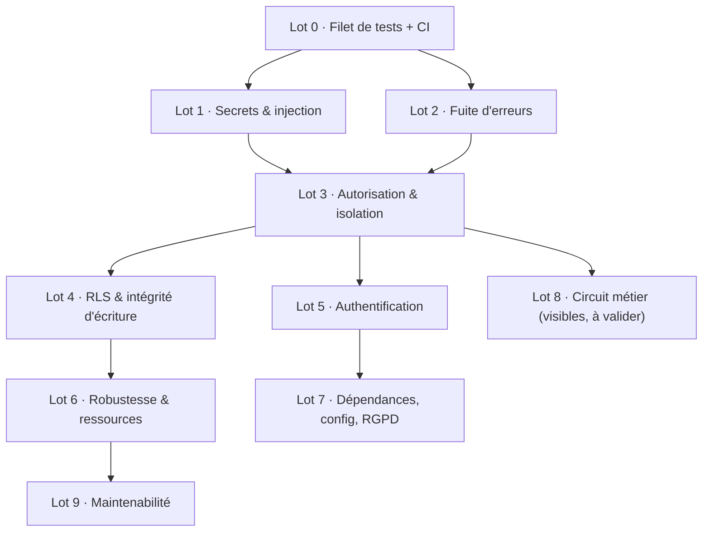

# 13 — Plan de remédiation

Ordonnancement des correctifs en **lots**. Un lot = un ensemble de constats
qui se corrigent ensemble (même module, ou même cause). Ce document donne la
**séquence** et les **dépendances** ; la conception détaillée de chaque
correctif (code, confrontation ASVS / cheat sheets) se fait lot par lot au
moment de l'implémentation, à partir des champs `Piste` et `Critère
d'acceptation` des fiches de [12-constats.md](12-constats.md).

- État : plan établi le 2026-10-13, après vérification (phase 2).
- Règle du projet : un correctif **invisible** par défaut. Les correctifs
  **visibles** (colonne « Visible ») passent par une **décision équipe** avant
  implémentation et font l'objet d'un **commit séparé** (voir
  [11-methode.md](11-methode.md#constats-métier)).

## Vue d'ensemble

| Lot | Thème | Constats | Gravité max | Visible | Dépend de |
|---|---|---|---|---|---|
| 0 | Filet de tests + CI | V-16.1, V-16.2 | Haute | non | — |
| 1 | Secrets & injection | V-08, V-07 | Critique | non | 0 |
| 2 | Fuite d'erreurs | V-11, V-28, V-15.1, V-15.2 | Haute | partiel | 0 |
| 3 | Autorisation & isolation | V-03, V-06, V-04.1, V-04.2, V-24, V-02.4 | Haute | partiel | 0, (1) |
| 4 | RLS & intégrité d'écriture | V-05.1, V-05.2, V-10.1, V-10.4, V-26, V-09 | Moyenne | non | 3 |
| 5 | Authentification | V-17, V-18, V-19, V-20, V-21, V-22, V-23, V-12.1, V-12.2, V-12.3 | Haute | partiel | 0 |
| 6 | Robustesse & ressources | V-13.1, V-13.2, V-13.3, V-13.4, V-29, V-30, V-27, V-14.1, V-14.2, V-14.3 | Haute | partiel | 4 |
| 7 | Dépendances, config, RGPD | V-32, V-33, V-34, V-36, V-35, V-25, V-10.2 | Moyenne | partiel | — |
| 8 | Circuit métier | M-01.1, M-01.2, M-02, M-03, M-04, M-05.1, M-06, M-07, M-08, M-09 | Critique | **oui** | 3 |
| 9 | Maintenabilité | V-00, V-01, V-02.2, V-02.3, V-31 | Moyenne | non | tous |

Les points d'**hygiène** (`H-01`…`H-47` de `12-constats.md`) ne font pas de lot :
chacun se traite au passage, dans le lot qui touche son fichier.

---

## Lot 0 — Filet de tests + CI · d'abord, sans exception

**Pourquoi en premier.** La contrainte « invisible pour l'utilisateur » est
intenable sans filet de non-régression : tout le reste du plan réécrit du code
qui n'a aujourd'hui **aucun test** (V-16). Les 8 PoC de `poc/` sont le point de
départ : ils deviennent des tests de caractérisation qui figent le comportement
**actuel** avant chaque correction.

- **V-16.1** — outillage de test + tests des chemins critiques (connexion,
  création de note, circuit de validation par rôle, accès aux reçus). Convertir
  les PoC en tests.
- **V-16.2** — CI : lint, typecheck, build, tests à chaque push.

**Sortie attendue** : `npm test` vert, CI active. Aucun lot suivant ne démarre
sans ce filet.

## Lot 1 — Secrets & injection · urgent, rapide

Deux failles graves, confirmées par PoC, à effort S, indépendantes.

- **V-07** (Critique) — liste blanche des colonnes de tri ; rejeter toute autre
  valeur. Test : le PoC d'injection ne discrimine plus vrai/faux.
- **V-08** (Haute) — lire `AUTH_SECRET` depuis l'environnement, échouer au
  démarrage s'il est absent ou trivial. **Effet unique** : les sessions en
  cours sont invalidées une fois au déploiement (reconnexion) — acceptable,
  à annoncer.

## Lot 2 — Fuite d'erreurs · socle commun

Prépare le lot 3 (un accès refusé doit répondre proprement) et referme la
surface de V-07.

- **V-11** (Haute) — ne plus renvoyer `message`/`stack` ; message générique +
  log serveur corrélé. *Visible* : les messages SQL affichés aujourd'hui
  disparaissent (amélioration).
- **V-28** (Moyenne) — faire passer **toutes** les routes par le gestionnaire
  d'erreur (supprimer les `return withUserScope(...)` sans `await`).
- **V-15.1** (Faible) — codes HTTP d'erreur cohérents (401 vs 403).
- **V-15.2** (Faible) — messages d'erreur en français. *Visible* (texte).

## Lot 3 — Autorisation & isolation · le cœur

Le lot structurant. **V-03** fournit le prédicat d'accès unique dont dépendent
les autres ; à faire en premier dans le lot.

- **V-03** (Haute) — un seul `canSee/canDecide(acteur, note)` et un
  `decide(...)` paramétré, appelés par toutes les routes (fusion de l'ancien
  V-02.1).
- **V-02.4** (Moyenne) — `requireUser()/requireRole()` partagés (prérequis de
  V-03).
- **V-06** (Haute) — le reçu côté manager passe par le même prédicat.
- **V-04.1** (Moyenne) — le manager attribué doit être de la même entreprise.
- **V-04.2** (Moyenne) — refuser les cycles d'organigramme. *Visible* (un
  rattachement devient refusé) → décision équipe.
- **V-24** (Faible) — valider le format des identifiants d'URL.

## Lot 4 — RLS & intégrité d'écriture · ensemble obligatoire

**Attention dépendance critique** : passer l'app à un rôle non-superuser
(V-05.1) **casse la création de note** tant qu'il n'existe pas de policy
`UPDATE` pour le propriétaire — donc V-05.1, V-05.2 et V-10.1 se livrent dans
le **même lot**, jamais isolément.

- **V-05.1** (Moyenne) — rôle applicatif soumis à la RLS ; déplacer les
  requêtes légitimes qui s'appuyaient sur le superuser.
- **V-05.2** (Faible) — policy RH filtrée par entreprise.
- **V-10.1** (Faible) — création de note atomique (note + reçu).
- **V-10.4** (Moyenne) — valider montant/date/description (évite les 500).
- **V-26** (Moyenne) — contraintes et index manquants au schéma.
- **V-09** (Moyenne) — décision conditionnée au statut (`UPDATE … WHERE status
  = 'pending'`), ferme le TOCTOU.

## Lot 5 — Authentification

Plusieurs correctifs **visibles** : à cadrer avec l'équipe (quels domaines
refuser, faut-il la vérification d'email maintenant ou en évolution).

- **V-17** (Haute, *visible*, effort L) — vérification de possession de
  l'email. Peut être reporté en évolution si trop lourd ; décision équipe.
- **V-18** (Haute) — limite de débit connexion/inscription/OCR (429).
- **V-19** (Moyenne) — revalider rôle/existence (ou raccourcir la session).
- **V-20, V-21** — énumération et timing des comptes.
- **V-22, V-23** (*visibles*) — mots de passe courants, durée de session.
- **V-12.1** (Moyenne) — inscription transactionnelle (pas d'entreprise sans RH).
- **V-12.2** (Faible) — conflit d'email géré proprement.
- **V-12.3** (Moyenne, *visible*) — emails insensibles à la casse (migration).

## Lot 6 — Robustesse & ressources

- **V-13.1, V-13.2** (Haute) — mutualiser/borner les workers OCR ; borne de
  taille **avant** lecture (413).
- **V-13.3, V-13.4** (*visibles*) — PDF et fiabilité OCR → décision équipe.
- **V-29, V-30** — délais base/pool/S3 ; erreurs du pool `pg`.
- **V-27** (Moyenne) — journaliser décisions et événements de sécurité.
- **V-14.1, V-14.2, V-14.3** (Faible) — correctifs d'affichage client.

## Lot 7 — Dépendances, configuration, RGPD · parallélisable

Indépendant du reste, peut démarrer en parallèle dès le lot 0.

- **V-32** (Moyenne) — mettre à jour Next.js (16.4.0).
- **V-33** (Faible) — épingler / sortir de la bêta `next-auth`.
- **V-34** (Moyenne) — restreindre l'exposition réseau Postgres/LocalStack.
- **V-36** (Moyenne) — pas de comptes de seed hors dev.
- **V-10.2** (Faible) — clés de reçu non séquentielles, ne plus exposer
  `receiptKey`.
- **V-35** (Moyenne, *visible*, L) — suppression / rétention des données
  personnelles → relève surtout d'une évolution, décision équipe.
- **V-25** (Faible) — en-têtes de sécurité HTTP.

## Lot 8 — Circuit métier · 100 % visible, décision équipe d'abord

Tous ces correctifs **changent ce que l'utilisateur voit**. Ils ne partent en
implémentation qu'une fois **validés** par l'équipe (statut `à valider` dans
chaque fiche). Commits séparés des correctifs techniques.

- **Bugs métier évidents** (justifiés par eux-mêmes) : M-01.1, M-01.2 (notes
  sans valideur), M-02 (créer un manager), M-06 (nom au lieu de l'id tronqué),
  M-07 (« racine »), M-08 (manager rétrogradé), M-09 (date future).
- **Choix discutables** (argumentaire requis) : M-03 (domaines publics), M-04
  (total hors rejetées), M-05.1 (traçabilité des décisions).

Ordre conseillé : M-02 d'abord (débloque la création de managers, dont
dépendent plusieurs autres), puis M-01.x.

## Lot 9 — Maintenabilité · en continu

À faire au fil des lots plutôt qu'en bloc : chaque lot qui touche un module en
profite.

- **V-00** — corriger/supprimer les commentaires trompeurs.
- **V-01** — supprimer la couche morte `domain/ports/adapters/utils`.
- **V-02.2, V-02.3** — mutualiser DTO/types et utilitaires client.
- **V-31** (L) — extraire logique et accès données hors des routes (chantier de
  fond, à décider selon l'appétit de l'équipe).

---

## Points en attente de décision équipe

| Sujet | Fiches | Question |
|---|---|---|
| Vérification d'email | V-17 | Maintenant, ou évolution (invitation) ? |
| Domaines de messagerie publics | M-03 | Liste de refus, ou invitation obligatoire ? |
| Durée de session / mots de passe | V-22, V-23 | Quelles valeurs ? |
| PDF et OCR | V-13.3, V-13.4 | Exclure le PDF, ou le rendre ? |
| RGPD | V-35 | Portée de la suppression / rétention |
| Tout le lot 8 | M-xx | Valider chaque changement visible |
| Refactor de fond | V-31 | Le mener, ou s'en tenir au strict nécessaire ? |
