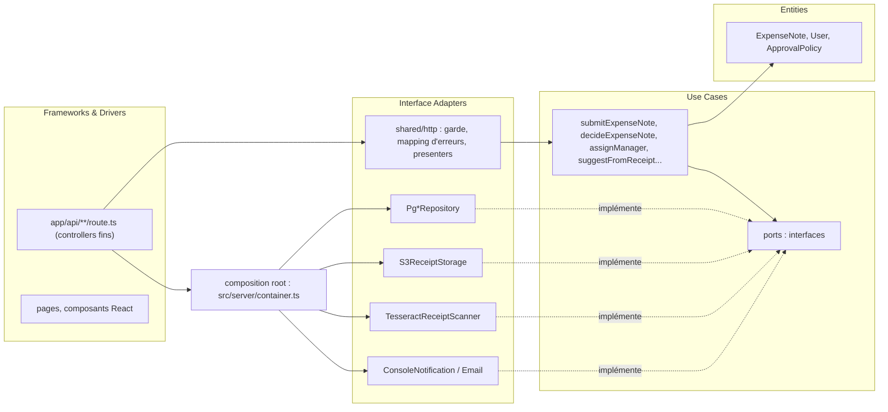

# 20 · Audit d'architecture ARLA : écarts à combler pour la soutenance

* Pour qui : l'équipe archi, avant de lancer les refactos et de préparer les slides.
* Point de départ : l'audit sécurité et métier (`10` à `14`), le harnais de tests (`tests/`, `docs/tests/`) et les attendus du cours ARLA (Clean Architecture, Hexagonale, monolithe modulaire, multitenant, asynchrone, ADR/HLD/LLD/DAT).
* État relevé le 2026-10-13 sur `main` (`d354ae2`). Les `chemin:ligne` dérivent dès que le code bouge : revérifier avant d'agir.
* Identifiants : `A-xx` = constat d'architecture (nouveau). Les `V-xx`, `M-xx` (audit), `SEC-xx`, `ROB-xx`, `PERF-xx`, `MET-xx` (tests) sont cités tels quels.

## 0. Verdict en cinq points

1. **L'audit existant est un très bon audit de sécurité, pas encore un audit d'architecture.** Il cote 63 constats (OWASP, intégrité, métier) et le harnais de tests les rend mesurables. Il manque la lecture « cours ARLA » : découpage en domaines, inversion des dépendances, ports et adapters, stratégie asynchrone, et les livrables ADR / HLD / LLD / DAT. Ce document comble cet écart.
2. **On audite le code réel.** Une application Next.js, une base PostgreSQL, un stockage S3, un OCR local, aucun traitement asynchrone. Les refactos portent sur ce qui existe : le domaine qui concentre le plus de règles est la **validation** des notes (`approve` / `reject`, qui voit quoi, concurrence).
3. **Le cœur du problème architectural est unique : tout vit dans les route handlers.** 13 fichiers de routes portent chacun authentification, contrôle de rôle, règle d'accès, SQL, mapping JSON et gestion d'erreur. La couche `domain/ports/adapters` existe mais n'est branchée nulle part : c'est exactement le « piège fréquent » du cours (bonne terminologie, métier toujours couplé à l'infra).
4. **La cible recommandée est un monolithe modulaire en Clean Architecture « légère »** (un seul déployable Next.js, modules par domaine, ports en interfaces, adapters dédiés, composition root). Pas de microservices, pas de bus : ni la taille de l'équipe, ni la charge, ni le contrat figé ne les justifient (§3, ADR-001).
5. **La refacto doit corriger les 17 défauts du registre en passant par la nouvelle architecture**, pas à côté : chaque défaut corrigé devient la preuve qu'un principe du cours a été appliqué (§5). C'est la meilleure histoire à raconter en 15 minutes, et elle est vérifiable par `make test`.

## 1. Attendus du cours face à l'existant

| Attendu ARLA | État dans le dépôt | Déjà couvert par | Écart à combler | État au 2026-10-29 |
|---|---|---|---|---|
| Audit chiffré et hiérarchisé | 63 fiches cotées, 8 PoC, synthèse | `10`, `12`, `13`, `poc/` | Ajouter l'angle architecture (ce document) | fait : statut des 63 constats (`12`), bilan avant / après (`10`) |
| Monolithe modulaire, domaines découplés (DDD) | Aucun module : `src/app/api/**` mélange tout | `V-31` (coté Moyenne, effort L, « à décider ») | **Décider** et faire `V-31` : c'est le cœur de la note ARLA, pas une option | fait : 6 modules dans `src/modules/` (ADR-002, ADR-003) |
| Clean / Hexagonale, inversion des dépendances | `src/domain`, `src/ports`, `src/adapters` morts | `V-01` propose de **supprimer** | Inverser la recommandation : **ranimer et brancher** la couche (A-02) | fait : couche ranimée et branchée (ADR-004), règles ESLint bloquantes (ADR-005) |
| Testabilité du métier avec infra mockée | Aucun test unitaire sur `main` ; 115 unitaires sur la branche `tests/p2-unitaires` (non fusionnée) qui figent l'existant | Branche `tests/p2-unitaires` | Fusionner, puis tester les **use cases** avec des fakes de ports | fait : 246 tests unitaires, ports en mémoire |
| Contrôle de rôle centralisé | 12 fichiers (10 routes, 2 pages) + `layout.tsx` testent `role` à la main | `V-02.4`, `V-03` | Garde unique + politique d'accès unique (A-03, A-04) | fait : garde `route({ role })`, plus aucun test de rôle dans les routes (10 avant) |
| Isolation multitenant structurelle | Filtres `WHERE company_id = ...` écrits à la main ; RLS contournée (superuser) | `V-03`, `V-05.1`, `V-06`, `SEC-02`, `SEC-03`, `SEC-09` | Repository scopé par acteur + RLS effective (A-04) | fait : ports bornés à l'acteur et RLS effective (SEC-02, SEC-03, SEC-09) |
| Asynchrone justifié (DLQ, idempotence, contrat, corrélation) | Aucun asynchrone. OCR synchrone dans la requête | `V-13.1`, `PERF-01` (sous l'angle perf) | ADR « pas de bus pour l'OCR » + outbox pour la notification si on la livre (A-08, A-10) | décidé : aucun asynchrone sans usage (ADR-008), recette outbox dans `AGENTS.md` |
| Twelve Factor | Secret en dur, config lue à l'import, pas de validation | `V-08`, `SEC-04`, `V-36` | Module de config validé au démarrage (A-11) | fait : `src/config.ts`, démarrage refusé si la configuration manque (SEC-04) |
| ADR, HLD, LLD, DAT | Aucun | La spec de tests prévoit `docs/tests/adr/` (pas encore écrit) | Produire `docs/architecture/` (§7) | fait : ADR-001 à ADR-020, `HLD.md`, `DAT.md` ; LLD = `README.md` de chaque module |
| Live coding conforme aux guidelines | Gabarit E2E prévu, pas de gabarit d'architecture | `tests/e2e/_template.spec.ts` (prévu) | Gabarit de module + guide « ajouter une fonctionnalité » (§8) | prêt : `AGENTS.md`, `ajouter-une-fonctionnalite.md`, recette asynchrone |

## 2. Constats d'architecture

Format court par constat : **problème constaté** (fichiers), **concept du cours**, **décision proposée**, **tradeoff**, **preuve** (tests qui basculent).

### A-01 · Le métier vit dans les route handlers (pas de couches)

* **Constaté** : chaque `src/app/api/**/route.ts` enchaîne `auth()`, test de rôle, SQL écrit à la main, mapping JSON, `try/catch`. 11 appels `getPool()` directs dans `src/app`, 7 copies du mapping ligne SQL vers JSON (3 fonctions `toExpenseNote`, 4 blocs inline dans `approve` / `reject`). Les 4 routes `approve` / `reject` (manager et RH) sont quasi identiques. Reprend `V-31`, `V-02.2`.
* **Concept** : Clean Architecture (Entities, Use Cases, Interface Adapters, Frameworks) ; Screaming Architecture ; un controller ne contient pas de règle.
* **Décision** : les routes deviennent des **controllers fins** : lire la requête, appeler un use case, présenter le résultat. Use cases et entités dans `src/modules/<domaine>/`, SQL dans des adapters `Pg*Repository`.
* **Tradeoff** : plus de fichiers, un peu d'indirection. Accepté parce que le gain est mesurable (les 4 routes de décision deviennent un seul use case `decideExpenseNote`) et que le harnais garantit la parité.
* **Preuve** : 181 tests `@parity` toujours verts, contrat OpenAPI respecté, unitaires des use cases avec fakes.

### A-02 · Couche hexagonale décorative

* **Constaté** : `src/domain/ExpenseNote.ts`, `src/domain/User.ts`, `src/ports/*`, `src/adapters/*` ne sont importés par aucune route (`V-01`). `S3ReceiptAdapter` n'est qu'un wrapper de `src/lib/storage.ts`. Le message d'erreur du domaine (`Cette note a déjà été tranchée.`) diffère de celui de l'API (`Already decided`) : les deux logiques ont divergé.
* **Concept** : le « piège fréquent » du cours : terminologie correcte, métier toujours couplé à l'infra.
* **Décision** : **inverser la piste de `V-01`** (« supprimer la couche morte »). On la **ranime** : `ExpenseNote.approve()` / `reject()` deviennent la règle exécutée par le use case, l'adapter S3 devient le seul accès au stockage. Raisons : la branche `tests/p2-unitaires` fige déjà l'API publique de `ExpenseNote` et `User` (règle : « seul le chemin d'import peut suivre un module déplacé »), et c'est la démonstration la plus parlante en soutenance (« le code avait l'air hexagonal, maintenant il l'est »).
* **Tradeoff** : on garde une API de domaine qu'on n'aurait peut être pas dessinée ainsi. Coût faible, cohérence avec les tests existants.
* **Point d'attention** : l'erreur métier du domaine doit être traduite par l'adapter HTTP en `409 {"error":"Already decided"}` (contrat). Le message français du domaine ne doit jamais sortir tel quel.

### A-03 · Contrôle de rôle recopié partout

* **Constaté** : 14 contrôles `session?.user` dans 13 fichiers de routes, dont 10 avec test de rôle, plus `src/app/manager/page.tsx:7`, `src/app/hr/page.tsx:7` et `src/app/layout.tsx:79`. Les codes divergent : `401` côté manager, `403` côté RH (`V-15.1`), et le contrat **fige** cette incohérence (`criteres-fin-de-migration.md` §2.1).
* **Concept** : vérification de rôle centralisée dans un service ou middleware de permissions unique.
* **Décision** : un `requireActor(request, { role })` unique dans `src/modules/identity/` (ou un wrapper `withActor(handler, policy)`), qui renvoie un `Actor` typé `{ id, role, companyId }` et applique le standard : `401` si non connecté, `403` si connecté sans le rôle.
* **Tradeoff** : corriger l'incohérence change des réponses figées par les tests de parité (`authz-matrix.ts`), à faire évoluer avec la team Tests. Accepté : le professeur attend la correction de ce genre de bizarrerie, et la correction tient en une ligne une fois la garde centralisée, ce qui démontre le bénéfice de la refacto (D12, [22-comportements-a-corriger.md](22-comportements-a-corriger.md) `B-01`, `B-02`).
* **Proxy** : `src/proxy.ts` exclut `/api` du matcher. Ne pas déplacer le contrôle des API dans le proxy : Next.js recommande de revérifier au plus près de la donnée, et les codes 401/403 par route seraient perdus.

### A-04 · Isolation entre entreprises reposant sur des `WHERE` manuels

* **Constaté** :
  * `expense_notes` n'a pas de `company_id` ; l'entreprise est retrouvée par jointure sur `users` et sous requête `(SELECT company_id FROM users WHERE id = $1)` recopiée dans 5 routes RH.
  * La seule route qui a oublié le filtre fuit (`V-06`, `SEC-02`, PoC) ; l'assignation de manager ne vérifie pas l'entreprise (`V-04.1`, `SEC-03`).
  * La RLS existe mais l'app se connecte en superuser (`V-05.1`, `SEC-09`) ; la policy RH n'est pas filtrée par entreprise (`V-05.2`) ; `users` et `companies` n'ont pas de RLS ; pas de policy `UPDATE` propriétaire (la création de note casserait si la RLS devenait effective).
* **Concept** : l'isolation ne doit jamais reposer sur un filtre ajouté à la main dans chaque requête ; isolation structurelle (repository scopé par tenant, RLS).
* **Décision** : **défense en profondeur sur deux niveaux**, livrés ensemble (lot 4 de `13`) :
  1. **Applicatif** : les repositories ne s'obtiennent qu'à partir d'un `Actor` (`repositories.for(actor)`), qui pose `app.current_user_id` et ajoute le scoping entreprise. Une seule implémentation de « qui voit quelle note » : `ApprovalPolicy` (reprend `V-03`).
  2. **Base** : RLS effective via `SET LOCAL ROLE` sur un rôle sans privilège exposé par `APP_DB_ROLE` (option proposée par la team Tests, `DATABASE_URL` inchangée), policies complétées (`UPDATE` propriétaire, RH filtré par entreprise).
* **Option à arbitrer** : ajouter `expense_notes.company_id`. Gain : policies RLS simples, index direct pour `PERF-02`. Contrainte : `scripts/seed.mjs` et `scripts/seed-perf.mjs` insèrent dans `expense_notes` sans cette colonne et doivent rester compatibles avec la baseline. Solution : colonne remplie par un **trigger `BEFORE INSERT`** depuis `users.company_id`, dans une **nouvelle** migration. Aucun script à modifier.
* **Tradeoff** : la RLS ajoute un coût par requête (sous requêtes des policies). À mesurer avec `make test-perf` : si une liste régresse, simplifier les policies grâce à `company_id` plutôt que de renoncer.
* **Preuve** : `SEC-02`, `SEC-03`, `SEC-09` passent à `fixed: true` ; `poc/V-05`, `poc/V-06` passent de `CONFIRMÉ` à `RÉFUTÉ`.

### A-05 · Règle de décision dupliquée et non atomique

* **Constaté** : 4 routes font `SELECT` puis `UPDATE ... WHERE id = $1` sans condition sur le statut (`V-09`, `ROB-02`, PoC : une note approuvée **et** rejetée).
* **Concept** : la règle (« seule une note en attente se tranche ») appartient au domaine ; la garantie d'atomicité appartient à l'adapter de persistance.
* **Décision** : un use case `decideExpenseNote({ actor, noteId, decision })` : charge la note via le repository scopé, appelle `note.approve()` ou `note.reject()`, persiste avec `UPDATE ... WHERE id = $1 AND status = 'pending'`. Zéro ligne mise à jour signifie conflit : `409 Already decided`. Le port `ExpenseNoteRepository.saveDecision()` documente cette sémantique (verrou optimiste).
* **Tradeoff** : verrou optimiste plutôt que `SELECT ... FOR UPDATE` : pas de verrou tenu, une requête de moins, comportement déterministe.
* **Preuve** : `ROB-02` vert (20 décisions simultanées, une seule `200`) ; test unitaire du use case avec un faux repository qui simule le conflit.

### A-06 · Objets échangés non typés et recopiés

* **Constaté** : `Record<string, unknown>` partout, 7 copies du mapping, types redéclarés dans chaque composant client (`V-02.2`, `V-02.3`).
* **Concept** : Interface Adapters (presenters) ; Contract First.
* **Décision** : un presenter unique `toExpenseNoteDto()` par forme de réponse, typé à partir du contrat (`docs/api/openapi.yaml`). Option : générer les types depuis le contrat (`openapi-typescript`) et les partager avec le client, puis `make api-diff` pour prouver l'absence de changement cassant.
* **Tradeoff** : une dépendance de dev de plus si on génère ; sinon types écrits à la main, vérifiés par les tests de contrat.

### A-07 · Erreurs : fuite et gestion contournée

* **Constaté** : `src/lib/errors.ts:5` renvoie `message` et `stack` (`V-11`, `SEC-05`) ; 7 routes font `return withUserScope(...)` sans `await` dans un `try` : l'erreur échappe au `catch` (`V-28`).
* **Concept** : séparation des responsabilités : le domaine lève des erreurs métier typées (`NotFound`, `AlreadyDecided`, `InvalidInput`, `InvalidManager`), seul l'adapter HTTP les traduit en codes et messages du contrat.
* **Décision** : un `handle(route)` commun qui `await` toujours, mappe les erreurs métier vers le contrat, journalise le reste avec un identifiant de corrélation et répond `500 {"error":"Erreur interne"}` sans stack.
* **Preuve** : `SEC-05`, `ROB-03a` à `ROB-03e`.

### A-08 · OCR : appel synchrone et bloquant dans la requête

* **Constaté** : `suggestFields` crée et détruit un worker Tesseract à chaque appel (`src/lib/ocr.ts:118`), sans limite de concurrence, de délai ni de taille (`V-13.1`, `V-13.2`, `PERF-01`, `SEC-08`). PoC : 4 requêtes = 4 workers, +80 Mo.
* **Concept** : la résilience du système est celle de son maillon le plus lent ; questionner l'utilité de l'asynchrone avant de l'introduire.
* **Décision (ADR-004)** : **rester synchrone**, sans bus. Port `ReceiptScanner` dans le module `receipt-scan`, adapter `TesseractReceiptScanner` avec un **pool de workers réutilisés** (taille bornée), file d'attente bornée, délai maximal (au delà : suggestion vide, déjà le comportement en cas d'erreur), limite de 10 Mo **avant** lecture du corps.
* **Pourquoi pas d'asynchrone ici** : la suggestion sert à **pré remplir le formulaire** pendant que l'utilisateur le remplit ; il attend la réponse par conception. Un traitement différé imposerait un polling ou un push côté UI (changement visible, contrat cassé) pour un traitement local de quelques secondes qui ne dépend d'aucun service externe instable. Le cours dit « asynchrone uniquement si lent **ou** externe et instable » : ici c'est lent mais local, et la borne de concurrence suffit.
* **Évolutivité gagnée** : le port permet de remplacer Tesseract par un service OCR distant sans toucher au use case. Ce jour là, et seulement ce jour là, l'asynchrone redevient une question (A-10).
* **Preuve** : `PERF-01` (p95 OCR ≤ 50 % de la baseline), `SEC-08`, références OCR inchangées (`tests/fixtures/ocr/`).

### A-09 · Création de note non atomique

* **Constaté** : `INSERT` de la note, puis upload S3, puis `UPDATE` hors transaction (`src/app/api/expense-notes/route.ts:88-106`) ; S3 en panne laisse une note sans reçu (`V-10.1`, `ROB-01`). La clé est dérivée d'un compteur séquentiel (`SEC-06`). Le type est contrôlé sur le MIME déclaré (`SEC-07`).
* **Concept** : cohérence entre deux ressources attachées (Postgres, S3) sans transaction distribuée ; compensation.
* **Décision** : use case `submitExpenseNote` : valider (montant, date, description, signature du fichier), générer une clé opaque (UUID), **téléverser d'abord**, puis insérer la note dans une seule transaction. Si l'insertion échoue, supprimer l'objet (compensation) ou le laisser orphelin (nettoyage différé). Un objet orphelin est sans impact métier ; une note sans reçu en a un.
* **Tradeoff** : objets orphelins possibles, assumés et documentés.
* **Preuve** : `ROB-01`, `SEC-06`, `SEC-07`, `ROB-03b` à `ROB-03d`.

### A-10 · Aucun asynchrone, notifications jamais envoyées

* **Constaté** : `NotificationPort` jamais appelé (`MET-09`, évolution listée dans `14`). Aucun mécanisme d'échange asynchrone : rien à « unifier ».
* **Concept** : Producer / Broker / Consumer, ack, DLQ, idempotence, Contract First, corrélation ; chorégraphie vs orchestration.
* **Décision (ADR-005, conditionnelle)** : aucun asynchrone tant qu'aucune fonctionnalité ne le justifie. **Si** une fonctionnalité en a besoin (par exemple notifier l'auteur d'une décision, éventuellement celle imposée au live coding), utiliser le **pattern Outbox sur Postgres** plutôt qu'un broker :
  * le use case `decideExpenseNote` écrit l'événement `ExpenseNoteDecided.v1` dans une table `outbox` **dans la même transaction** que la décision (pas de double écriture incohérente) ;
  * un worker lit l'outbox, appelle `NotificationPort`, marque le message traité (ack) ;
  * **idempotence** : clé unique `(event_type, note_id)` et marquage `processed_at` : un rejeu ne renvoie pas de notification ;
  * **DLQ** : après N échecs, statut `dead` + raison, visible pour traitement manuel ;
  * **contrat** : type TypeScript versionné + validation à l'écriture et à la lecture ;
  * **corrélation** : l'identifiant de la requête HTTP est stocké dans le message et repris dans les logs du worker.
* **Pourquoi pas un broker (Kafka, SQS, Redis)** : un seul producteur, un seul consommateur, faible volume, une équipe étudiante qui l'opère. L'outbox donne les garanties demandées par le cours sans nouvelle brique à exploiter. Évolutif : on pourra relayer l'outbox vers un broker plus tard sans changer le producteur.
* **Où tourne le worker** : Next.js n'a pas de processus de fond fiable. Options : script `npm run worker` lancé à côté (ajout, pas de renommage de scripts existants) ou déclenchement à la fin de la requête (`after()` de Next.js) avec reprise par le script. À trancher dans l'ADR.

### A-11 · Configuration et Twelve Factor

* **Constaté** : secret Auth.js codé en dur, variable ignorée (`src/lib/auth.ts:8`, `V-08`, `SEC-04`) ; identifiants S3 remplacés par `''` s'ils manquent (`src/lib/storage.ts:13`) ; bucket lu à l'import du module ; aucun contrôle des variables au démarrage ; comptes de seed connus utilisables hors dev (`V-36`) ; logs `console.*` non structurés et sans corrélation (`V-27`).
* **Concept** : Twelve Factor (config par l'environnement, services externes comme ressources attachées, logs comme flux d'événements).
* **Décision** : un module `src/config.ts` qui lit et valide toutes les variables de `.env.example` une fois (échec explicite au démarrage si absente ou triviale), injecté dans les adapters par la composition root. Logger minimal structuré (JSON, `requestId`). Noms des variables inchangés (contrat).

### A-12 · Schéma et performance

* **Constaté** : aucun index sur `user_id`, `manager_id`, `company_id`, `status` (`PERF-02`) ; contraintes manquantes (`V-26`).
* **Décision** : nouvelle migration (jamais modifier la migration initiale). Index guidés par les 3 requêtes de liste. À combiner avec A-04 (`company_id`).
* **Règle de refacto** : **un use case = autant d'allers retours SQL qu'aujourd'hui, pas plus**. Le barème met 0 si l'application est plus lente : la couche repository ne doit pas transformer une jointure en deux requêtes. Mesurer avec `make test-perf` avant de fusionner chaque étape.

### A-13 · Retiré

Sans objet pour ce projet (une seule base, aucun besoin multi région). Identifiant conservé pour ne pas renuméroter.

### A-14 · Front : duplication et logique d'affichage

* **Constaté** : formatteurs et appels `fetch` recopiés dans 3 composants (`V-02.3`), `src/utils/format.ts` inutilisé, date décalée en fuseau négatif (`BUG-01`).
* **Décision (KISS)** : ne pas restructurer le front au delà du nécessaire. Brancher `src/utils/format.ts` (déjà testé sur `tests/p2-unitaires`), corriger `BUG-01`, un petit client API typé par les DTO de A-06. Les textes de l'interface ne bougent pas.

### A-15 · Aucun livrable d'architecture

* **Constaté** : pas d'ADR, de HLD, de LLD, de DAT. La spec de tests annonce `docs/tests/adr/` (ADR-T01 à T03), pas encore écrits.
* **Décision** : produire `docs/architecture/` (§7). C'est un attendu explicite du cours et le support des 15 minutes d'audit.

## 3. Architecture cible (HLD)

### 3.1 Choix de découpage : monolithe modulaire

| Critère | Monolithe modulaire | Microservices |
|---|---|---|
| Délai, time to market | une PR à la fois, harnais existant réutilisé tel quel | réécriture de l'exploitation, du déploiement, des tests |
| Coût, maturité de l'équipe | une app, un `make dev` | N déploiements, traçabilité distribuée, monitoring |
| Contrat figé (routes, ports 3000/5433/4567, scripts npm) | respecté naturellement | quasi impossible sans passerelle |
| Sécurité | une frontière de confiance | N frontières à sécuriser |
| Scalabilité | suffisante pour la charge mesurée (k6) ; modules extractibles plus tard | non requise aujourd'hui |

Décision : monolithe modulaire (ADR-001). Les modules communiquent par **ports** (interfaces) et use cases, jamais en lisant les tables d'un autre module.

### 3.2 Modules (bounded contexts)

| Module | Responsabilité | Use cases | Ports (sortie) | Adapters |
|---|---|---|---|---|
| `identity` | session, acteur courant, inscription, connexion | `getActor`, `signup`, `login` | `UserRepository`, `PasswordHasher` | Auth.js, bcrypt, Postgres |
| `organization` | entreprises, annuaire, rattachement manager | `listDirectory`, `assignManager` | `OrganizationRepository` | Postgres |
| `expenses` (soumission) | créer et lister ses notes, reçu | `submitExpenseNote`, `listMyExpenseNotes`, `getMyReceiptUrl` | `ExpenseNoteRepository`, `ReceiptStorage` | Postgres, S3 |
| `approval` (validation) | qui voit et tranche quelle note, décision | `listPendingForManager`, `listPendingForHr`, `decideExpenseNote`, `getReceiptUrlForApprover` | `ApprovalRepository`, `ReceiptStorage`, (`EventOutbox`) | Postgres, S3 |
| `receipt-scan` | suggestion OCR | `suggestFromReceipt` | `ReceiptScanner` | Tesseract (pool) |
| `notification` (si une fonctionnalité l'exige) | prévenir l'auteur d'une décision | `dispatchPendingNotifications` | `NotificationPort` | Console, puis email |
| `shared` | config, logger, erreurs, transaction, garde HTTP | | | |

Note de vocabulaire (cours) : Server Port ≈ Gateway ≈ Repository ici ; Application ≈ Use Case ; Adapter HTTP ≈ Controller (le `route.ts`).

### 3.3 Règle de dépendance



Règles vérifiables automatiquement (à mettre dans ESLint, `no-restricted-imports`) :

* `src/modules/*/domain/**` et `src/modules/*/application/**` n'importent ni `pg`, ni `@aws-sdk/*`, ni `tesseract.js`, ni `next`, ni `next-auth`, ni `@/lib/*`.
* Un module n'importe d'un autre module que son `index.ts` public (pas ses repositories).
* Seuls `infrastructure/**` et `src/server/container.ts` importent les SDK.

Rendre ces règles bloquantes en CI (`npm run lint`) est un argument fort en soutenance : l'architecture n'est plus une convention, elle est **vérifiée**.

### 3.4 Arborescence cible (Screaming Architecture)

```text
src/
├─ app/                         Next.js : pages et route handlers fins (inchangés côté URL)
├─ server/container.ts          composition root : instancie adapters et use cases
├─ config.ts                    variables d'environnement validées (Twelve Factor)
└─ modules/
   ├─ approval/
   │  ├─ domain/                ApprovalPolicy.ts, errors.ts
   │  ├─ application/           decideExpenseNote.ts, listPendingForManager.ts, ...
   │  ├─ ports/                 ApprovalRepository.ts   (un port = un fichier)
   │  ├─ infrastructure/        PgApprovalRepository.ts
   │  └─ index.ts               API publique du module
   ├─ expenses/                 même structure (ExpenseNote vit ici)
   ├─ organization/
   ├─ identity/
   ├─ receipt-scan/
   ├─ notification/
   └─ shared/                   http/, db/ (transaction, scoping), logger, errors
```

Les fichiers actuels de `src/domain`, `src/ports`, `src/adapters`, `src/utils` sont **déplacés** dans ce schéma (pas réécrits) : seule la ligne d'import des unitaires suit, ce que la team Tests autorise.

## 4. LLD : exemple du module `approval`

```ts
// modules/approval/ports/ApprovalRepository.ts
export interface ApprovalRepository {
  findDecidable(actor: Actor, noteId: NoteId): Promise<ExpenseNote | null>
  /** UPDATE conditionné à status = 'pending' ; false si une autre décision est passée avant. */
  saveDecision(note: ExpenseNote): Promise<boolean>
  listPending(actor: Actor): Promise<ExpenseNote[]>
}

// modules/approval/application/decideExpenseNote.ts
export function makeDecideExpenseNote(deps: { approvals: ApprovalRepository }) {
  return async ({ actor, noteId, decision }: DecideCommand): Promise<ExpenseNote> => {
    const note = await deps.approvals.findDecidable(actor, noteId)
    if (!note) throw new NotFoundError()
    const decided = decision === 'approve' ? note.approve() : note.reject() // lève AlreadyDecided
    if (!(await deps.approvals.saveDecision(decided))) throw new AlreadyDecidedError()
    return decided
  }
}
```

* `findDecidable` encapsule **la** règle « qui peut trancher quelle note » (rattaché direct pour un manager, manager racine de la même entreprise pour un RH). Une seule implémentation pour les 4 routes et pour la lecture du reçu (`V-06` fermé par construction).
* Le test unitaire du use case utilise un `InMemoryApprovalRepository` : note absente → `NotFound` ; note déjà tranchée → `AlreadyDecided` ; `saveDecision` qui renvoie `false` → `AlreadyDecided`. Aucune base, aucun Next.js : c'est la preuve de testabilité demandée par le cours.
* Les 4 routes deviennent : `export const POST = route({ role: 'manager', deniedStatus: 401 }, (ctx) => decide(ctx, 'approve'))`.

## 5. Plan de refacto incrémental

Approche « strangler » : une route ou un module à la fois, chaque PR verte sur `static`, `parity`, `defects`, sans régression de perf. Chaque étape **corrige des défauts en passant par la nouvelle architecture**, ce qui relie chaque principe du cours à une preuve.

| Étape | Contenu | Concept démontré | Défauts basculés | Vérification |
|---|---|---|---|---|
| 0 | Fusionner `tests/p2-unitaires` ; ajouter les règles d'import ESLint (en avertissement) ; `src/config.ts` | Testabilité, Twelve Factor | `SEC-04` | `make test`, `npm run test:unit` |
| 1 | `shared/http` : `route()` (garde + `await` + mapping d'erreurs + corrélation), presenters | Contrôle centralisé, adapters | `SEC-05`, `ROB-03a` | parité + contrat |
| 2 | Module `approval` : `ApprovalPolicy`, `decideExpenseNote`, `PgApprovalRepository` ; 4 routes de décision + 2 reçus valideur migrés | Clean Archi, domaine ranimé, verrou optimiste | `ROB-02`, `SEC-02` | unitaires du use case, `ROB-02` |
| 3 | Module `organization` : `assignManager` | Isolation par tenant | `SEC-03`, `ROB-03e` | `HR` parité |
| 4 | Module `expenses` : `submitExpenseNote`, liste triée par liste blanche, clé opaque, signature fichier, upload avant insert | Ports S3, compensation | `SEC-01`, `SEC-06`, `SEC-07`, `ROB-01`, `ROB-03b/c/d` | `EMP`, `RCPT` |
| 5 | Module `receipt-scan` : pool Tesseract borné, limite de taille | Maillon lent, ADR-004 | `SEC-08`, `PERF-01` | OCR de référence, `make test-perf` |
| 6 | Nouvelle migration : index, `company_id` + trigger, policies complétées ; `SET LOCAL ROLE` via `APP_DB_ROLE` | Isolation structurelle (RLS) | `SEC-09`, `PERF-02` | `make test-perf`, PoC `V-05` réfuté |
| 7 | Front : `utils/format`, client API typé | KISS | `BUG-01` | E2E en `America/New_York` |
| 7 bis | Métier fonctionnel : changement de rôle, validation des notes sans valideur, cycles, nom de l'auteur, codes HTTP, saisie, inscription (ordre du §3 de `22`) | Domaine au centre : une `ApprovalPolicy` unique répond à « qui valide quoi » | nouveaux défauts à ajouter au registre | tests mis à jour par la team Tests |
| 8 | ESLint d'architecture en erreur ; suppression de `src/lib/*` devenu vide ; ADR, HLD, LLD, DAT | Inversion des dépendances vérifiée | (tous à `fixed: true`) | CI verte, tag `soutenance` |

Dépendance dure (rappel de `13`) : l'étape 6 (RLS effective) n'est livrable qu'**après** que toutes les écritures passent par les repositories scopés, sinon la création de note casse.

`APP_DB_ROLE` est une nouvelle variable : l'ajouter à `.env.example` avec une valeur par défaut, sans renommer les existantes (le contrat interdit les renommages, pas les ajouts). À valider avec la team Tests.

## 6. Contraintes à ne pas oublier pendant la refacto

* **Contrat** : routes, messages anglais existants (`Already decided`, `Invalid manager`, `Not found`, `Unauthorized`), forme JSON dont `receiptKey`, textes de l'UI, scripts npm, ports, comptes de seed restent figés (`AGENTS.md`). Exceptions décidées : les comportements étranges de [22-comportements-a-corriger.md](22-comportements-a-corriger.md), corrigés **en ajout** (nouvelle route, nouveau champ) plutôt qu'en remplacement, après mise à jour des tests par la team Tests.
* **Performance** : 0 au barème si plus lent. Pas d'aller retour SQL supplémentaire ; `make test-perf` avant chaque fusion qui touche SQL, OCR ou listes.
* **Tests** : ne jamais modifier `tests/`, `playwright.config.ts`, `scripts/seed-e2e.mjs`, `.github/`. Les unitaires de `tests/p2-unitaires` figent l'API de `ExpenseNote`, `User`, `withUserScope`, `utils/*` : les déplacer, ne pas les casser.
* **Défauts métier `MET-01` à `MET-09`** : désormais dans le périmètre (le métier doit être totalement fonctionnel). `AGENTS.md` règle 5 et `docs/tests/criteres-fin-de-migration.md` §2.1 et §2.3 disent encore le contraire : les réviser avec la team Tests avant la première PR métier.
* **Commentaires trompeurs (`V-00`)** : les supprimer au passage dans chaque fichier touché.

## 7. Livrables d'architecture à produire

Dans `docs/architecture/` :

| Livrable | Contenu | Sert à |
|---|---|---|
| `adr/ADR-001-monolithe-modulaire.md` | contexte, décision, alternatives (microservices, statu quo), conséquences | §3.1 |
| `adr/ADR-002-clean-architecture-legere.md` | couches, règle de dépendance, ESLint, ranimer plutôt que supprimer `domain/` | A-01, A-02 |
| `adr/ADR-003-isolation-multitenant.md` | repository scopé + RLS effective + `company_id` par trigger | A-04 |
| `adr/ADR-004-ocr-synchrone-borne.md` | pas de bus, pool borné, délai, alternatives rejetées | A-08 |
| `adr/ADR-005-outbox-notifications.md` | outbox vs broker, idempotence, DLQ, contrat versionné, corrélation | A-10 (si une fonctionnalité l'exige) |
| `adr/ADR-007-decision-atomique.md` | verrou optimiste vs `FOR UPDATE` | A-05 |
| `HLD.md` | vue système (§3), modules, flux principaux | slides |
| `LLD/<module>.md` | ports, use cases, schéma des tables, séquences | revue de code |
| `DAT.md` | stack, déploiement, config, sécurité, exploitation, tests, perf | document de synthèse |

Pour les slides (15 min) : avant / après de l'arborescence (Screaming Architecture), le graphe de dépendances avant / après, le tableau rouge → vert des 17 défauts, la courbe de perf (`perf-history`), et 3 ADR choisies pour montrer des tradeoffs **assumés** (dont au moins une décision de ne pas faire : ADR-004).

## 8. Préparer le live coding

La fonctionnalité est **imposée par les professeurs le jour de la soutenance**. Il n'y a donc rien à coder à l'avance pour elle : la préparation consiste à rendre la codebase et l'agent IA capables d'absorber **n'importe quelle** fonctionnalité en respectant les guidelines. Ce travail se fait **en fin de migration**, quand l'architecture est stable.

### 8.1 Ce que le jury regardera

La fonctionnalité doit : vivre dans le bon module, passer par les ports existants, respecter l'isolation par entreprise et la garde centralisée, n'utiliser l'asynchrone que si c'est justifié, arriver avec ses tests. Les prompts doivent être détaillés et explicables.

### 8.2 À préparer en fin de migration

* **`AGENTS.md` soigné** : la carte des modules, la règle de dépendance, où placer quoi (entité, use case, port, adapter, route), la garde `route()`, le scoping par entreprise, les contraintes du contrat, la commande de vérification. C'est le levier principal : l'agent doit respecter l'architecture sans qu'on la répète dans chaque prompt.
* **Guide `docs/architecture/ajouter-une-fonctionnalite.md`** : étapes (test rouge, port, use case et son unitaire, adapter, route, `make test`), avec un exemple réel tiré d'un module migré.
* **Règles ESLint d'architecture bloquantes** : garde fou automatique si l'agent importe de l'infrastructure dans le domaine.
* **Une répétition à blanc** sur une fonctionnalité inventée par l'équipe, pour tester l'`AGENTS.md` et chronométrer.

### 8.3 Points d'attention pour le jour J

* **Contrat** : une nouvelle fonctionnalité ajoute du contrat, elle ne doit pas en casser. Les schémas OpenAPI des tests sont stricts (un champ en trop échoue) : préférer de **nouvelles routes** à l'ajout de champs dans les réponses existantes.
* **Asynchrone** : ne l'introduire que si la fonctionnalité appelle un traitement lent ou un service externe instable (A-10). Savoir expliquer pourquoi on le fait, ou pourquoi on ne le fait pas.
* **Métier** : si la fonctionnalité recoupe un `MET-xx`, le traiter comme une évolution demandée, pas comme une correction.
* **Trame de prompt** à adapter en direct :

```text
Contexte : lis AGENTS.md et docs/architecture/ajouter-une-fonctionnalite.md.
Objectif : <fonctionnalité donnée par le jury>.
Contraintes :
* identifie le module concerné et justifie ce choix avant de coder ;
* aucun import d'infrastructure dans modules/*/domain ni modules/*/application ;
* accès aux données uniquement par un repository scopé par l'acteur courant ;
* garde de rôle via route(), jamais de test de rôle dans le handler ;
* asynchrone uniquement si le traitement est lent ou dépend d'un service externe ;
* commence par le test unitaire du use case avec des ports simulés, puis implémente.
Vérification : npm run lint && npm run typecheck && npm run test:unit && make test.
```

## 9. Décisions à prendre en équipe

Le détail, avec les pour et contre de chaque option, est dans [21-decisions-architecture.md](21-decisions-architecture.md) (D1 à D19). Les comportements étranges et le métier à rendre fonctionnel sont inventoriés dans [22-comportements-a-corriger.md](22-comportements-a-corriger.md).
