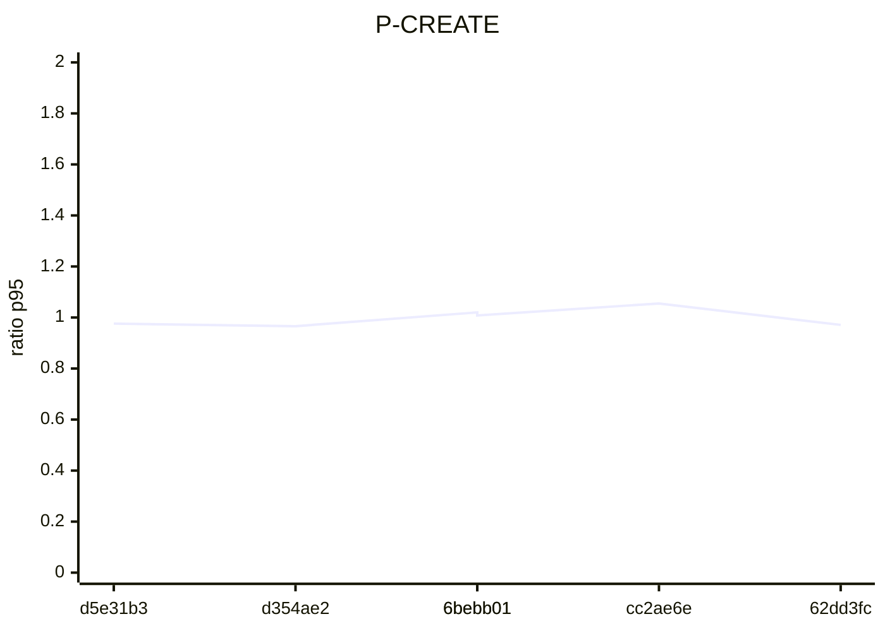
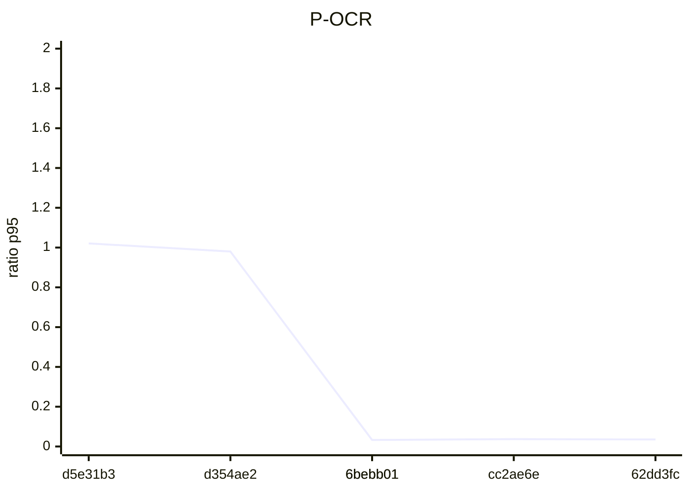

# Performance — progression de la migration

Ratio p95 version courante / baseline (1 = identique, < 1 = plus rapide).

| Scénario | `d5e31b3` | `d354ae2` | `6bebb01` | `6bebb01` | `cc2ae6e` | `62dd3fc` |
|---|---|---|---|---|---|---|
| P-EMP | 1.00 | 1.04 | 0.78 | 0.78 | 0.77 | 0.74 |
| P-MGR | 0.99 | 0.90 | 0.63 | 0.60 | 0.65 | 0.65 |
| P-HR | 1.01 | 0.83 | 0.18 | 0.18 | 0.17 | 0.17 |
| P-USERS | 0.97 | 0.99 | 0.97 | 0.91 | 1.00 | 1.00 |
| P-CREATE | 0.98 | 0.97 | 1.02 | 1.01 | 1.05 | 0.97 |
| P-OCR | 1.02 | 0.98 | 0.03 | 0.03 | 0.04 | 0.04 |
| P-MIX | 1.01 | 1.03 | 0.51 | 0.49 | 0.53 | 0.53 |
| P-LOGIN | 0.97 | 0.99 | 1.00 | 0.98 | 0.96 | 0.99 |

```mermaid
xychart-beta
  title "P-EMP"
  x-axis ["d5e31b3", "d354ae2", "6bebb01", "6bebb01", "cc2ae6e", "62dd3fc"]
  y-axis "ratio p95" 0 --> 2
  line [1.005, 1.044, 0.776, 0.778, 0.768, 0.737]
```

```mermaid
xychart-beta
  title "P-MGR"
  x-axis ["d5e31b3", "d354ae2", "6bebb01", "6bebb01", "cc2ae6e", "62dd3fc"]
  y-axis "ratio p95" 0 --> 2
  line [0.988, 0.895, 0.63, 0.599, 0.65, 0.647]
```

```mermaid
xychart-beta
  title "P-HR"
  x-axis ["d5e31b3", "d354ae2", "6bebb01", "6bebb01", "cc2ae6e", "62dd3fc"]
  y-axis "ratio p95" 0 --> 2
  line [1.011, 0.833, 0.176, 0.18, 0.173, 0.172]
```

```mermaid
xychart-beta
  title "P-USERS"
  x-axis ["d5e31b3", "d354ae2", "6bebb01", "6bebb01", "cc2ae6e", "62dd3fc"]
  y-axis "ratio p95" 0 --> 2
  line [0.97, 0.987, 0.969, 0.906, 0.997, 1.002]
```





```mermaid
xychart-beta
  title "P-MIX"
  x-axis ["d5e31b3", "d354ae2", "6bebb01", "6bebb01", "cc2ae6e", "62dd3fc"]
  y-axis "ratio p95" 0 --> 2
  line [1.012, 1.034, 0.51, 0.487, 0.525, 0.53]
```

```mermaid
xychart-beta
  title "P-LOGIN"
  x-axis ["d5e31b3", "d354ae2", "6bebb01", "6bebb01", "cc2ae6e", "62dd3fc"]
  y-axis "ratio p95" 0 --> 2
  line [0.967, 0.993, 1.001, 0.983, 0.96, 0.991]
```
